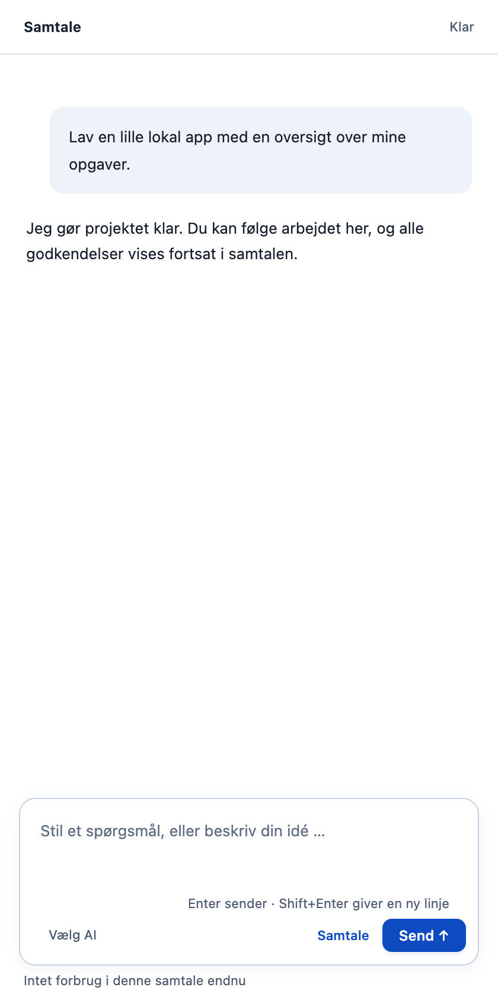
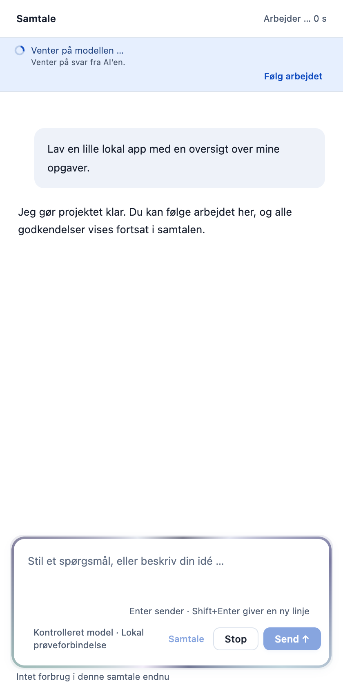
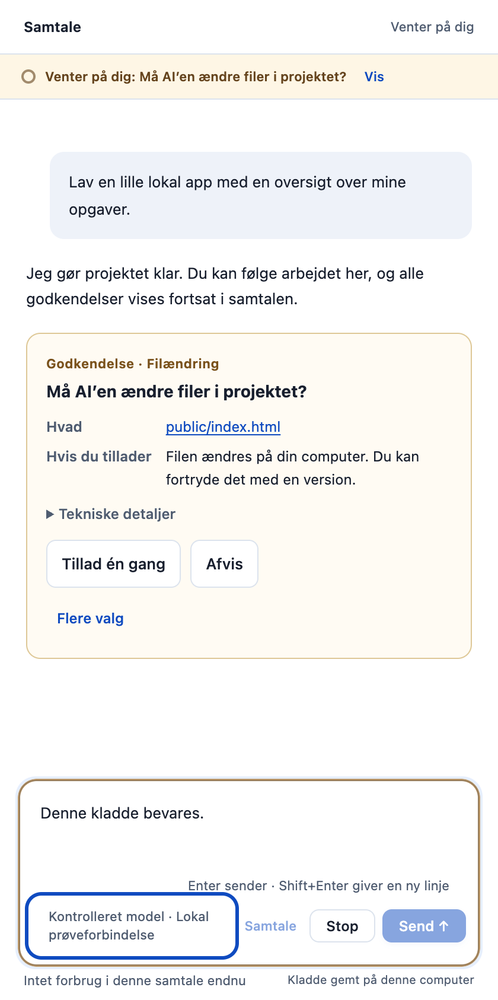
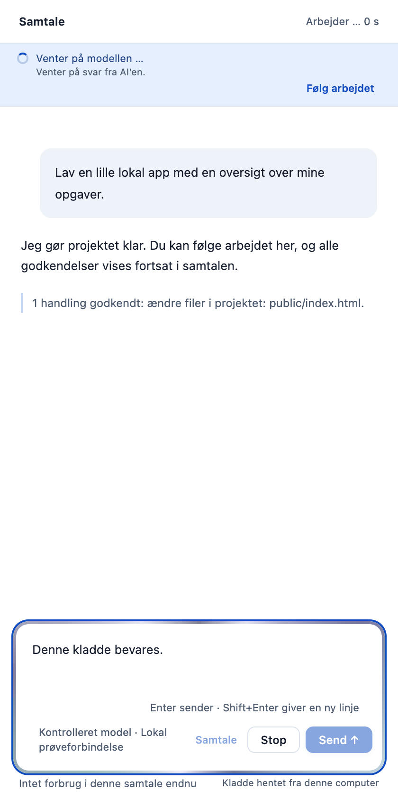
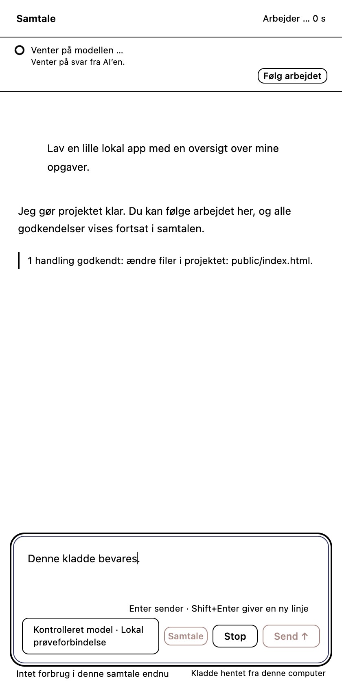
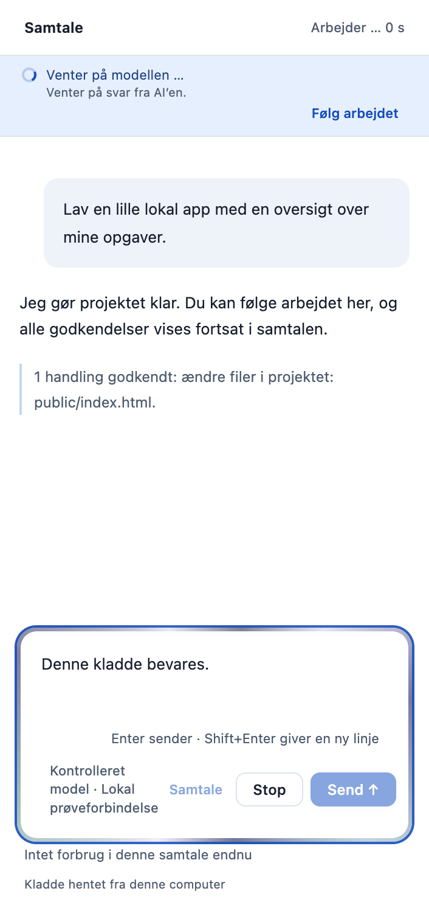

# F28: En lyskant, der følger arbejdet i samtalen

Når Aura arbejder, er den eksisterende statustekst let at overse, mens man skriver eller læser længere oppe i samtalen. F28 tilføjer en rolig lyskant rundt om skrivefeltet, så aktiviteten også kan ses dér, hvor man fortsætter dialogen.

Det er en visuel tilføjelse til den eksisterende status. Kanten måler hverken fremskridt eller kvalitet, og den er ikke et bevis på, at opgaven er lykkedes.

## Det oplever brugeren

| Tilstand i den åbne samtale | Skrivefeltets kant |
| --- | --- |
| Aura arbejder eller starter en opgave | En metallisk kant bevæger sig roligt rundt med fem sekunder pr. omgang og et diskret skær. |
| Aura afventer et svar eller en værktøjsgodkendelse | En varm, stillestående kant. Den eksisterende tekst fortæller, hvad der venter. |
| Opgaven er afsluttet, stoppet eller har fået en afsluttende fejlstatus | Arbejdskanten slukker. |
| En anden samtale arbejder i baggrunden | Ingen arbejdskant i den ledige samtale, brugeren har åben. |
| Systemet har reduceret bevægelse slået til | En stillestående arbejdskant uden rotation eller slør. |
| Systemet bruger tvungne kontrastfarver | Dekorationen skjules, og aktivitet bruger systemets kantfarve. Tastaturfokus bevares. |

Skifter brugeren mellem samtaler, følger kanten den valgte samtales tilstand. Hvis flere spørgsmål eller godkendelser venter, starter animationen først igen, når de alle er besvaret. En fejltekst alene slukker ikke markeringen, hvis motoren fortsat melder, at kørslen er aktiv.

## Skærmbilleder fra den rigtige app-renderer

Billederne bruger et opdigtet projekt og kontrollerede hændelser til Electron-rendereren. De viser den faktiske brugerflade og betjening, men er ikke dokumentation for et gennemført kald til en AI-udbyder. Testen bruger ingen konto, nøgle eller cloudmodel.

### En ledig samtale



### Aura arbejder



### En godkendelse venter



### Reduceret bevægelse



### Systemets kontrastfarver



### Et smalt vindue



## Afgrænsning og bevarede funktioner

Produktændringen består af én afledning af den aktive samtales tilstand i `desktop/ui/app.js` og et dekorativt CSS-lag i `desktop/ui/styles.css`. Kanten fylder ikke i layoutet og kan ikke opfange museklik. Ingen nye pakker, tilladelser, netværkskald eller IPC-handlinger tilføjes til appen.

Planlægning, værktøjsgodkendelser, modelvalg, gemte samtaler, kladder, Stop-knappen og onboarding beholder deres eksisterende forløb. Eksisterende statustekst, `aria-busy` og tastaturfokus bevares. F20, Privacy Gate og andre ændringer fra Aura 1 indgår ikke i dette bidrag.

Sammenligningsgrundlaget er originalens `main` og udgivelsen `v0.6.0-beta.1` på commit `dce68ea74a199ca214ab535a16ff22765d8ee8de`, kontrolleret 23. oktober 2026. Originalen har allerede fokusmarkering og tekststatus; F28 tilføjer den tilstandsbestemte arbejdskant.

## Afprøvning

Syv nye adfærdstests afprøver de faktiske statusfunktioner: arbejde, flere ventende valg, genoptagelse, afslutning, stop, fejl, gamle ventetilstande og samtidige samtaler. De kontrollerer også, at visningen ikke ændrer kladde, plan eller godkendelsesdata.

- Nye F28-tests: **7/7 består**.
- Samlet desktoptest: **521/523 består**. Originalen har **514/516 beståede** på samme grundlag. Begge har præcis de samme to fejl i `desktop/tests/approvals.test.cjs`, ved linje 47 og 74: henholdsvis “Godkendelsen findes ikke længere.” og “Cannot read properties of undefined (reading 'properties')”. De fejl rettes ikke i denne præsentationsændring.
- CLI-test: **26/26 består**.

Den separate Electron-prøve består med **14/14 kontrolgrupper** og undersøger faktisk animation, tilstandsskift, godkendelsesklik, skift mellem samtaler, kladde, Stop, fejl og normal afslutning. Den undersøger også klik, tastaturbetjening, reduceret bevægelse, systemets kontrastfarver og en vinduesbredde på 720 pixels. Resultater og billeders kontrolsummer findes i [valideringsrapporten](composer-glow-validation.json).

Prøven er kørt på macOS med Electron 44.4.4 og Node 22.23.3. Tvungne kontrastfarver og reduceret bevægelse er afprøvet med Electron/Chromiums medieemulering. Windows, Linux, VoiceOver og rigtige AI-kald er ikke afprøvet i dette bidrag. Der er ikke bygget en distributionspakke, og GitHub Actions er ikke startet.

## Gentag prøverne

Fra projektroden med desktopafhængighederne installeret:

```sh
node --test desktop/tests/composer-glow.test.cjs
node --test --test-concurrency=1 desktop/tests/*.test.cjs
node --test cli/tests/*.test.cjs
```

Electron-prøven kræver desktopappens klargjorte runtime og et grafisk miljø. Fra `desktop/`:

```sh
AURA_GLOW_OUTPUT=/tmp/aura-composer-glow-results node scripts/verify-composer-glow.cjs
```

Den opretter sin egen midlertidige profil og et syntetisk projekt, lukker appen bagefter og gemmer screenshots samt en lokal detaljerapport. Den lokale rapport kan indeholde prøveprofilens filsti og skal gennemgås, før den deles. Den kontrollerede stop-/svaradfærd er en del af prøven og ændrer ingen produktkode.
