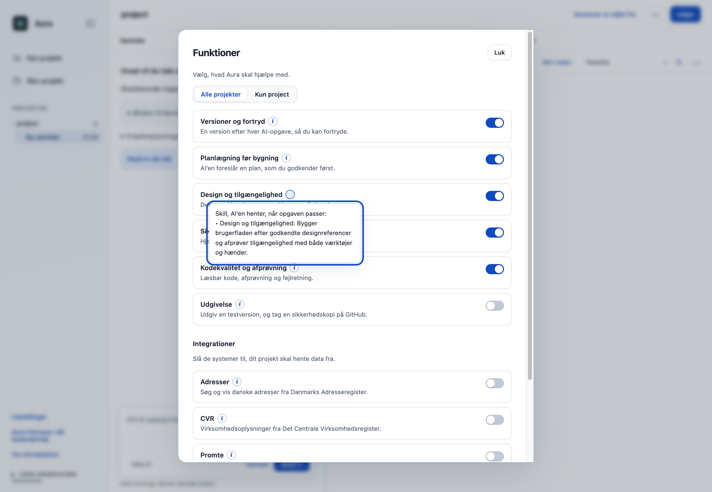
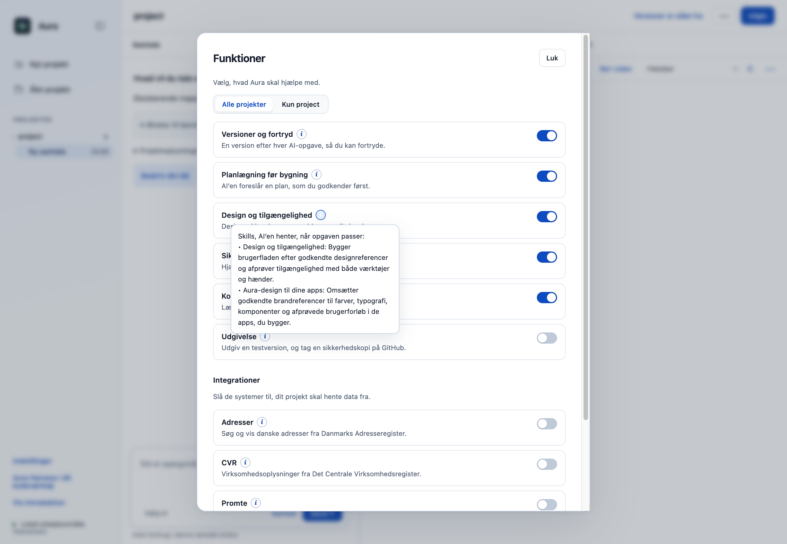
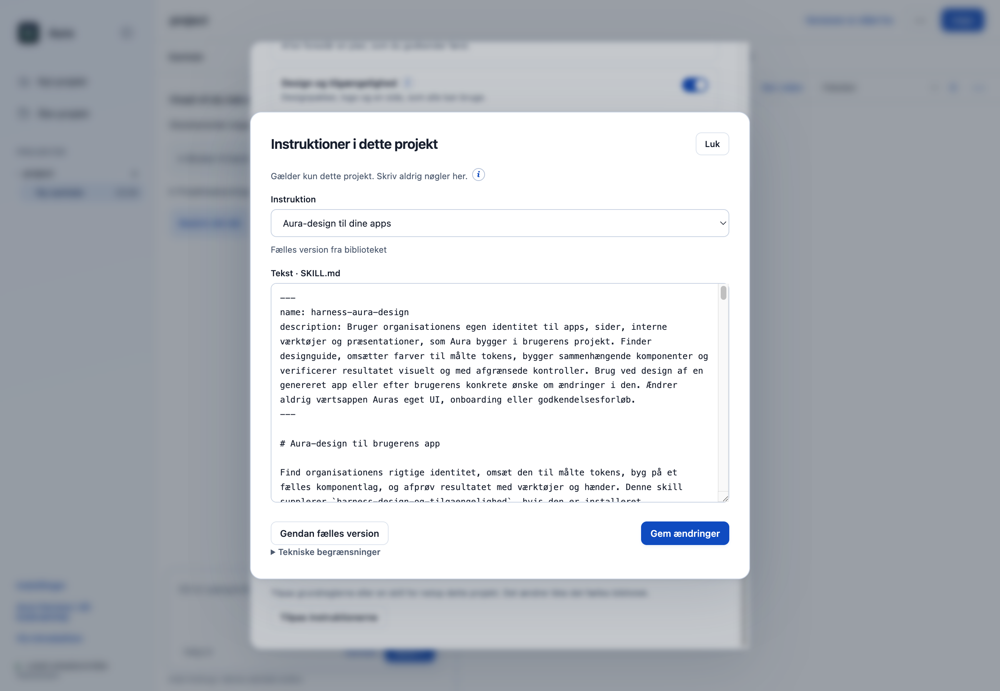

# PR-udkast: Aura-design i det fælles skillbibliotek

**Foreslået titel:** `feat: add a reviewed app design skill to the shared library`

**Mål:** `ai-alliancen-org/ai-harness` → `main`.

**Status:** Klargjort lokalt til gennemgang. Denne skill-PR er ikke indsendt. Den er selvstændig og kræver ikke onboarding-, glow-, modelbranding- eller andre åbne PR'er.

## Problem og løsning

Det eksisterende bibliotek har allerede en skill til design og tilgængelighed. Det mangler den samlede Aura-designmetode fra brandkilder og designbrief til designretning, målte tokens, komposition og konkret visuel afprøvning.

Dette bidrag tilføjer **Aura-design til dine apps** som `harness-aura-design` i det fælles bibliotek. Den bygger videre på Parthee Vijayamohans [Aura Design 1.1](https://github.com/Parthee-Vijaya/skills_claude/tree/88ef16cf3f8916911f5f26cb5a334dbdf332d1f5/aura-design) og gælder de løsninger, brugeren bygger i sit projekt.

Skillen følger **Design og tilgængelighed** med de eksisterende globale indstillinger og projektundtagelser. Den kan læses, tilpasses lokalt, nulstilles og eksporteres til brugerens eget kodeværktøj. Der indføres ingen ny indstilling eller dialog.

## Før og efter i original Aura

Billederne er optaget i den rigtige Electron-app på samme originale base `dce68ea`, med særskilte syntetiske profiler og projektdata. De er ikke mockups, og der er ikke ændret DOM eller CSS for at fremstille forskellen.

| Før: den eksisterende designskill | Efter: begge skills under samme funktion |
| --- | --- |
|  |  |

Den nye skill kan læses og tilpasses i den eksisterende instruktionsdialog:

## Hvad følger med?

- Brandmetode, designbrief, kvalitetsport og 43 beskrevne designretninger som inspiration.
- Vejledning til temaer, appmønstre, agentarbejdsrum, paneler, bevægelse og præsentationer.
- Læsbare HTML-/CSS-startere, fem valgfrie kompositionsopskrifter og et inputvalideret offline tokengeneratoreksempel.
- 16 Markdown-filer, kildeproveniens med alle 18 originalfilers hashes og bevaret MIT-notice.
- Opdateret katalog og reproducerbart genbyggede instruktionspakker og katalogsider. Pakkerne har 13 almindelige skills; fire integrationer vælges fortsat til særskilt.

De 43 retninger er beskrivelser, ikke importerede SkillsUI-filer eller 43 færdige temaer. Agentarbejdsrum er vejledning til brugerprojektet, ikke en ny agentmotor i Aura.

## Tilpasning til original AI Harness

Kilden kan ikke kopieres uændret til biblioteket: navnet, frontmatter, `scripts/`, `assets/` og `.txt`-notice passer ikke til det eksisterende format. Adapteren bruger `harness-`-navn, kun `name`/`description` og almindelige Markdown-referencer. Format- og stivalidering er bevaret.

Kildens netværksscanner og QA-filserver medfølger ikke. Hjælpekode installeres eller køres ikke automatisk. Generatoren er dokumentation til separat godkendt brug i projektet; den indfører ingen Python-afhængighed i appen. Kildens udefinerede `--t-hero` er rettet til det eksisterende `--t-3xl` i layoutreferencen, og kontrast/input samt CSS-tokenkontrakten er afprøvet.

Der er ingen ændringer i værtsappens UI, onboarding, motor, modelvalg, planer, godkendelser eller fil-/netværksrettigheder og ingen nye afhængigheder. EUPL-1.2 og den medfølgende MIT-notice bevares. Eksterne logoer og fonte kræver fortsat en særskilt rettighedsafklaring.

## Afprøvning

Afprøvet lokalt på macOS Apple Silicon med Node 22.23.3, originalens OpenCode 1.18.33 og Electron 44.4.4:

- **38/38 fokuserede prøver**, heraf syv nye: globalt/projektvist til- og fravalg, passiv referenceindlæsning og oprydning ved fravalg, uændrede tilladelser, installation/fjernelse med bevarede brugerfiler, kontrastmåling i begge temaer, 18 afviste ugyldige input og faktiske CSS-tokenreferencer mod generatorens output.
- **Rigtig OpenCode med kontrolleret localhost-model:** tre scenarier, med/uden Git og under planlægning; 35 værktøjshandlinger. Den aktive skill og dens præcise reference kan læses. Fravalgte skills, ikke valgte private referencer, `.env` og `.git` forbliver afvist. Ingen nye tilladelsesspørgsmål. Dette måler motorens indlæsning og adgangsgrænser, ikke en ekstern models designkvalitet.
- **Native desktop:** syv baselinekontroller og 14 kontroller af porteringen. Skillen vises, lokal tilpasning overlever normal genstart, nulstilling genskaber den fælles tekst, og design fra/til virker. Projektets `AGENTS.md` er uændret. Ingen rendererfejl, registrerede Git-skrivninger eller initierede modelkald; ingen eksterne HTTP(S)-requests fra rendereren under prøven.
- **Workbench og CLI-indlæsning:** tre yderligere forløb med normal samtale, planlægning og CLI. Projektregler og begge designskills sendes; ændrede regler kræver ny gennemgang og starter ny modelsession.
- **Pakker:** alle 23 ZIP-pakker matcher installationens indhold og manifest; genbygningen er reproducerbar og katalogets lokale links er kontrolleret.
- **CLI:** 26/26 enhedsprøver.
- **Samlet desktopgate:** 521/523 består. De to fejl i `approvals.test.cjs` ved linje 47 og 74 er reproduceret uændret på originalens main. Der er ingen nye testfejl, og godkendelseskoden er ikke ændret af dette bidrag. Det samlede projekt kaldes derfor ikke fejlfrit.

Prøverne i `desktop/tests/aura-design.test.cjs` kan køres sammen med `library.test.cjs` og `workbench.test.cjs`. `desktop/scripts/verify-app-skills.cjs` bruger den faktiske medfølgende OpenCode-motor og en kontrolleret modelserver. Pakkeprøverne sammenligner ZIP-indhold og manifester med installationen samt en ny reproducerbar bygning.

**Begrænsninger:** Ingen fysisk Windows-/Intel-Mac-afprøvning, ingen ny DMG, ingen hosted CI og ingen test mod en betalt ekstern AI-model. Enhedsprøver, en kontrolleret model og screenshots dokumenterer ikke fuld WCAG-overholdelse, myndighedsgodkendelse eller en models pålidelighed. Skill Creator-hjælperens generiske validator kunne ikke køres uden det valgfrie PyYAML; originalens egen strengere biblioteksvalidering og konkrete prøver er kørt.

[Maskinlæsbar testkvittering](../aura-design-validation.json).

## Før indsendelse

Afstem eventuelt den nye skill i en feature-issue som beskrevet i CONTRIBUTING. Genkontrollér originalens aktuelle main. Når indsendelse er ønsket, publiceres branchens konkrete commit, og billederne i PR-beskrivelsen bindes til den offentliggjorte revision. Der startes ikke GitHub Actions.
