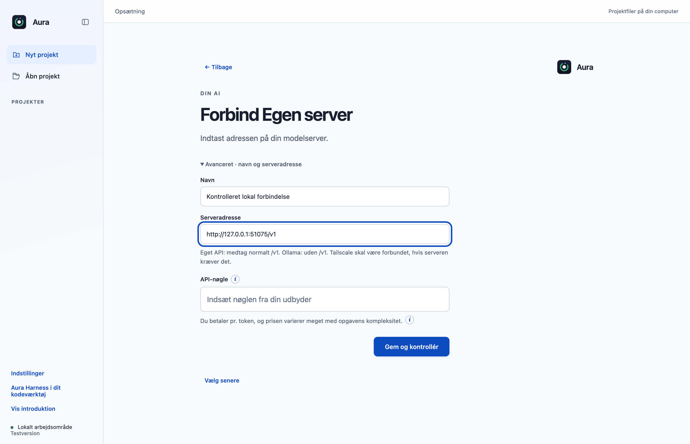
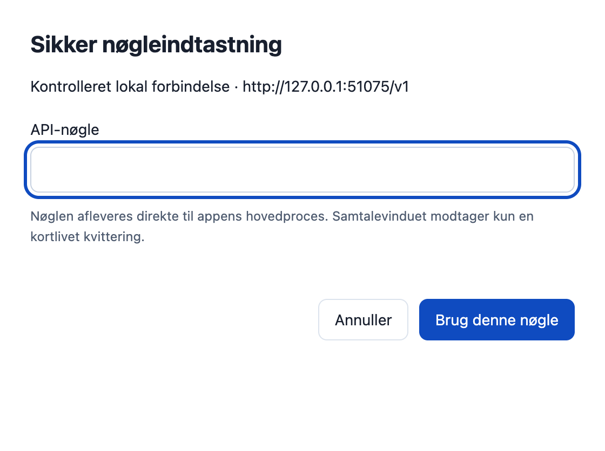

# Indtast AI-nøgler i et separat isoleret vindue (F05)

API-nøgler til AI-forbindelser indtastes nu i et lille separat vindue. Den almindelige samtale- og indstillingsside modtager kun en kortlivet engangskvittering, som hovedprocessen kan bruge til den samme forbindelse. Den eksisterende krypterede lagring og de eksisterende forbindelser bevares.

## Hvad ændres?

- Erstatter kun AI-forbindelsesformularens passwordfelt med den godkendte Indtast nøgle sikkert-handling og en status for, om en ny nøgle er klar. Udbydervalg, endpoint, eksisterende Gem-handling og onboarding bevares.
- Nøglevinduet bruger sandbox, context isolation, ingen Node-integration, ingen DevTools og en særskilt ikke-vedvarende Electron-session. Navigation, popups, downloads og andre netværksressourcer er afvist.
- Privat tilfældig IPC-kanal validerer afsender, hovedframe og præcis installeret dokumentadresse. Den almindelige preload kan ikke indsende en rå nøgle til connections:save.
- Kvitteringer udløber efter to minutter, bruges én gang og er bundet til hele forbindelsesformularen. Formularredigering, tilbagenavigation og lukning af forbindelses- eller hovedvinduet tilbagekalder dem; annullering af nøglevinduet udsteder ingen ny kvittering. En eksisterende gemt nøgle kan stadig bevares eller fjernes gennem den hidtidige formular.
- Mac-lukning af hovedvinduet tilbagekalder nøgler uden at ødelægge senere genåbning. Delte native testhjælpere og eksisterende opstarts-/forbindelsesprøver anvender samme nye indtastningsvej.

## Før og efter

Før: AI-nøglen indtastes i den almindelige forbindelsesformular. Efter: formularen har en diskret sikker-indtastningsknap, mens selve passwordfeltet kun findes i det separate vindue. Alle billeder er faktiske Electron-vinduer med syntetiske oplysninger.

| Før | Efter |
|---|---|
|  |  |

## Afprøvning

- 11 fokuserede prøver består: engangsbrug, udløb, binding til alle redigerbare felter, falsk afsender/subframe, crash/annullering/lukning og genåbning på macOS.
- Native Electron-prøve: faktisk sandbox/context isolation og særskilt session kontrolleres; DevTools kan ikke åbnes. Syntetisk nøgle lagres krypteret og når ikke den almindelige formular gennem det normale flow. Rå nøgle via save-IPC afvises; ændret formular ugyldiggør kvittering.
- Originalens native opstartsforløb består efter testmigration: ti udbydere, lokal opstart uden netværk, kontrolleret katalog, fejl/genoprettelse, modelvalg, genstart og manglende Git. Ingen produktionsnøgler bruges.
- Ingen rendererfejl eller Git-skrivninger i den isolerede nøgleprøve.
- Samlet desktopgate: **525/527 består**. De to fejl i `approvals.test.cjs` ved linje47 og74 findes også på uændret original `dce68ea`; der er ingen nye testfejl.
- CLI: **26/26 består**.

## Bevarelse og begrænsninger

Skærmer manuel AI-nøgleindtastning fra den almindelige renderer; det er ikke en påstand om beskyttelse mod kompromitteret hovedproces, operativsystem, udklipsholder eller skærmoptagelse. Andre hemmelighedsformularer i appen er ikke ændret. Faktisk provider-login og macOS-nøgleringsdialog med en produktionskonto er ikke afprøvet; prøven bruger safeStorage med syntetiske data og en kontrolleret lokal katalogserver. Eksisterende credential-/bundle-/profilidentiteter og krypteringsservice ændres ikke.

Prøvet lokalt på macOS Apple Silicon med Node22.23.3 og Electron44.4.4. Der er ikke brugt produktionskonti, startet GitHub Actions eller lavet en ny installationspakke. Windows og Intel-Mac er ikke fysisk afprøvet. Originalens onboarding, planer og konkrete værktøjs-/datagodkendelser bevares.

[Måleresultat: native-report.json](f05-native-report.json).

[Måleresultat: setup-native.json](f05-setup-native.json).
