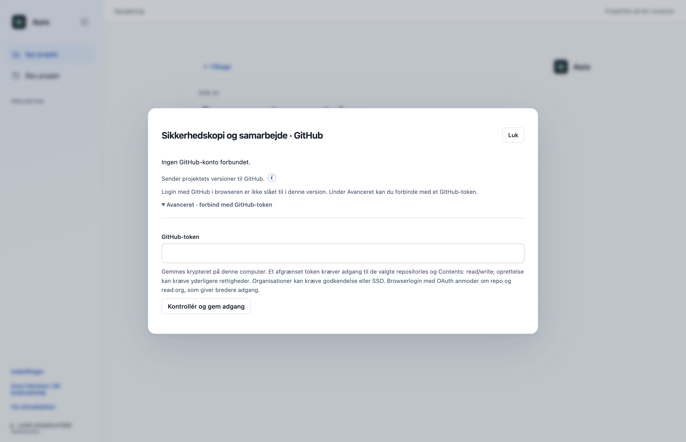
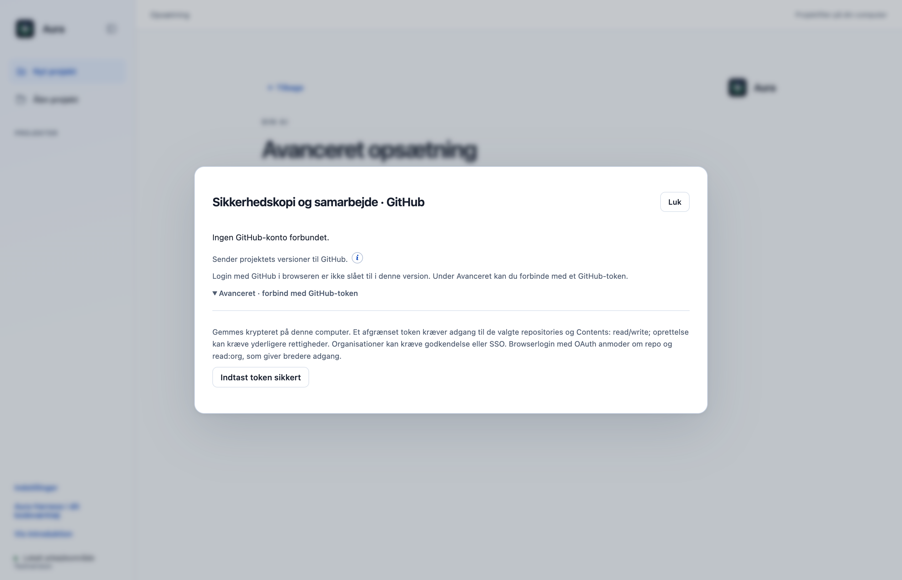
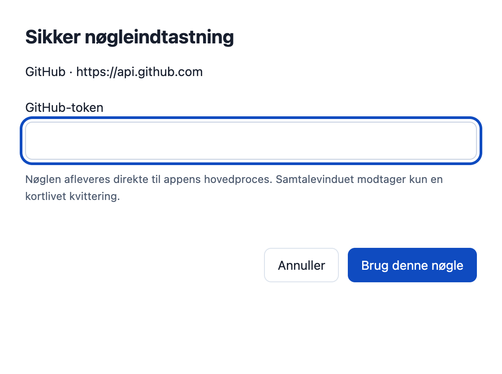
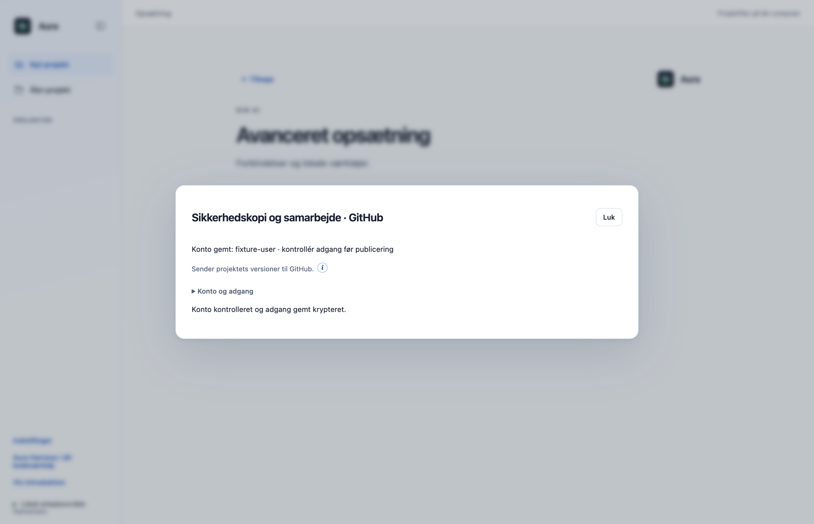

# Indtast GitHub-token i det isolerede nøglevindue (F06)

Manuel GitHub-tokenindtastning flyttes fra den almindelige delingsdialog til det isolerede nøglevindue. Delingsdialogen får kun en engangskvittering, og hovedprocessen kontrollerer kontoen og gemmer adgangen med den eksisterende kryptering. **Afhænger af F05 (#32); gennemgå og flet den sikre AI-nøgleinfrastruktur først.**

## Hvad ændres?

- Bevarer Avanceret · forbind med GitHub-token, adgangsvejledningen og den eksisterende kontostatus. Den godkendte Indtast token sikkert-knap åbner nu et separat passwordvindue med den faste modtager GitHub · https://api.github.com.
- Den almindelige hostingToken-IPC modtager kun en uigennemsigtig kvittering. Rå token, falske kvitteringer og kvitteringer udstedt til AI-forbindelser afvises, før kontoen kontaktes.
- Kvitteringen er bundet til formålet GitHub, den faste modtager og hovedprocessens aktuelle kontogeneration. Login, annullering og fjernelse af konto tilbagekalder kun de relevante GitHub-kvitteringer.
- Et eventuelt ventende OAuth-kontosvar pensioneres, før den manuelle indtastning starter, så et forsinket svar ikke kan udskifte kontoen under en nyere token-gennemgang.
- Browserlogin, repositoryvalg, krav om rettigheder/SSO samt eksisterende gennemgang og godkendelse før Git-push bevares.
- En formular-generation stopper sene handlinger efter Luk/Escape, både før nøglevinduet åbnes og efter at en kvittering er klar. Lukning kan derfor ikke udløse en ny nøglepopup eller et sent gemmeforsøg.

## Før og efter

Førbilledet er F05 og viser det hidtidige GitHub-passwordfelt i delingsdialogen. Efter: en sikker-indtastningsknap, separat native passwordvindue og konto efter kontrol. Billederne er taget i den faktiske Electron-app; kontoen og API-svaret er syntetiske.

| Før | Efter |
|---|---|
|  |  |

## Afprøvning

- 15 fokuserede credentialprøver består, herunder forkert afsender/formål, engangsbrug, kontogeneration og en faktisk GitHub-klasse med forsinket OAuth-save, der ikke må overskrive en nyere manuel indtastning.
- Native Electron-prøve gennem brugerflade, separat nøglevindue, kvittering, hovedproces, eksisterende GitHub.request og safeStorage. Den logiske /user-modtager er låst til GitHub; selve transportsvaret kommer fra en kontrolleret lokal server med et syntetisk token.
- Delingsformularen har intet token/passwordfelt. Normalflowet lægger ikke token i dens DOM eller formularværdier; gemte indstillinger indeholder kun krypteret token. Rå token og falsk kvittering afvises uden et ekstra API-kald.
- Annullering af nøgleindtastning bevarer den gemte konto. Ingen rendererfejl eller Git-skrivninger.
- To faktiske native lukningsraces består: forsinket Cancel-IPC og forsinket kvitteringssvar efter indtastning. Ingen efterfølgende nøglepopup, token-save, netværkskald eller kontoændring.
- To vedvarende UI-regressionstests kører den faktiske hosting.js med kontrollerede IPC-promises og bekræfter, at en lukket formular hverken åbner nøglefelt eller videresender en senere kvittering.
- Samlet desktopgate: **531/533 består**. De to fejl i `approvals.test.cjs` ved linje47 og74 findes også på uændret original `dce68ea`; der er ingen nye testfejl.
- CLI: **26/26 består**.

## Bevarelse og begrænsninger

Afhængig PR: diffen mod originalens main indeholder F05, indtil den er flettet og denne branch kan opdateres. Førbilledet viser F05, så GitHub-ændringen kan vurderes separat. Der er ikke brugt en rigtig GitHub-konto, ændret tokenrettigheder, oprettet repository eller udført eksternt push i native prøven. De eksisterende enhedsprøver af publishing og lokale Git-servere indgår fortsat i desktopgaten. Dette afgrænser manuel GitHub-tokenindtastning fra den almindelige renderer; kompromitteret hovedproces/OS og andre credentialformularer er ikke omfattet.

Prøvet lokalt på macOS Apple Silicon med Node22.23.3 og Electron44.4.4. Der er ikke brugt produktionskonti, startet GitHub Actions eller lavet en ny installationspakke. Windows og Intel-Mac er ikke fysisk afprøvet. Originalens onboarding, planer og konkrete værktøjs-/datagodkendelser bevares.

[Måleresultat: native-report.json](f06-native-report.json).

[Måleresultat: native-cancellation-report.json](f06-native-cancellation-report.json).
