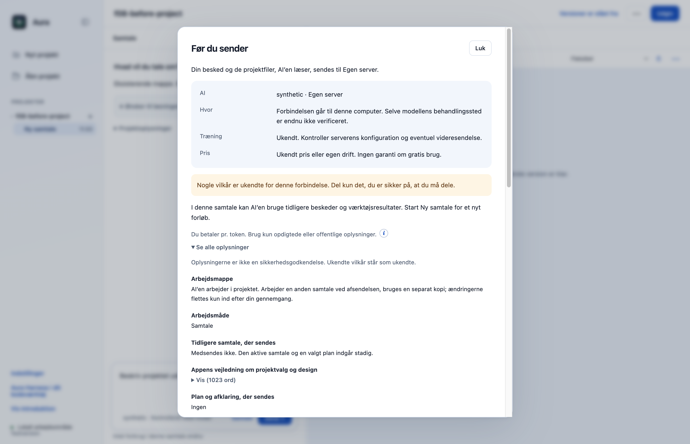
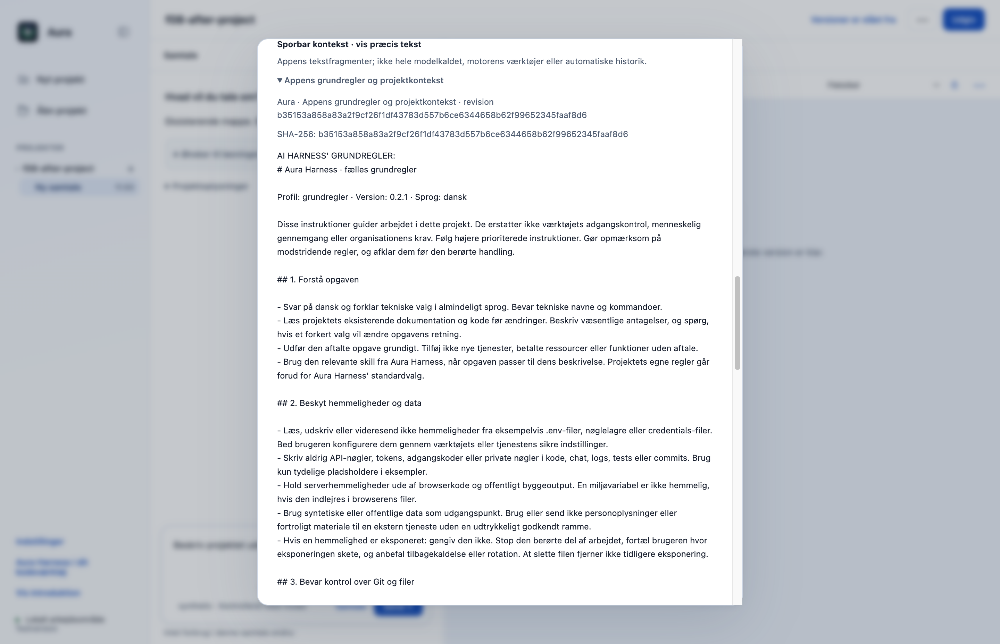
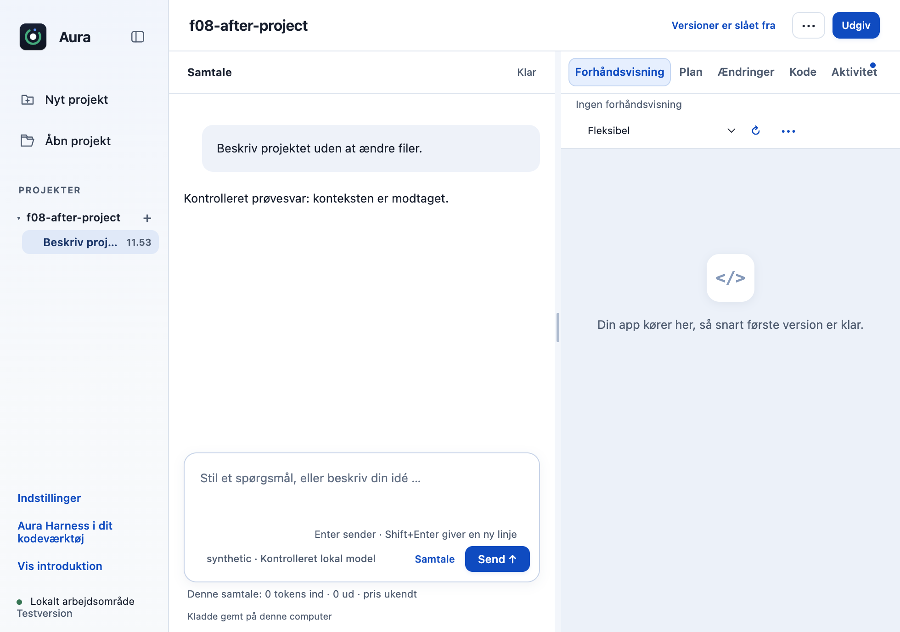

# F08: Bind gennemgået appkontekst til den konkrete afsendelse

Kontekstgennemgangen viste oplysninger om regler og projekt, men ikke alle appens præcise tekstfragmenter. PR’en samler fragmenterne ved forberedelsen og sender samme tekst. En ændret besked, plan eller kontekst kræver en ny forberedelse.

## Hvad ændres?

- “Sporbar kontekst” viser kilde, revision, SHA-256 og præcis tekst for appens egne fragmenter.
- En separat binding beskytter den konkrete afsendelse; motorens vedvarende sessionsidentitet bevares.
- Kontekst kontrolleres igen efter opstart og komprimering. Projektkopier genbruger det rigtige gennemgåede arbejdsområde.
- CLI og eksisterende integrationsprøver sender samme kontekstbinding; planlægning og bygning bevarer de normale godkendelser.

Når **Før du sender** vises, åbn **Se alle oplysninger → Sporbar kontekst · vis præcis tekst**, og fold fragmenterne ud. Gennemgå teksten før afsendelse; hvis beskeden, planen eller konteksten ændres efter forberedelsen, skal afsendelsen forberedes igen.

## Før og efter

Faktiske appbilleder: originalens datagennemgang og samme dialog med de gennemgåelige appfragmenter. Den smalle visning viser bevaret øvrigt layout.

| Før | Efter |
|---|---|
|  |  |

## Afprøvning

- Unitprøver kontrollerer ændret besked, gammel binding, ændrede regler under opstart/komprimering, ændret plan med samme id og gentagne afsendelser i projektkopi.
- Gyldig planlægning sender de præcise gennemgåede fragmenter og den aktuelle besked. CLI-happy-path kontrollerer bindingen.
- Faktisk OpenCode verify-agent: læsning under plan, afvist fremprovokeret skrivning, godkendt bygning, afvisning og stop består.
- verify-library-loading består for desktop/samtale, desktop/plan og CLI/direkte arbejde. Native appgennemgang sammenholdes med det faktiske kontrollerede modelkald.
- Samlet desktopgate: **523/525 består**. De to fejl i `approvals.test.cjs` ved linje 47 og 74 findes også på uændret original `dce68ea`; der er ingen nye testfejl.
- CLI: **27/27 består**.

## Bevarelse og begrænsninger

Originalens navigation, onboarding, projekter, planer og værktøjsgodkendelser bevares. De viste tillæg til de eksisterende kontroller er særskilt godkendt. Omfatter appens egne tekstfragmenter. Motorens automatiske historik, værktøjsdefinitioner og dynamiske scratch-/kopiinstruktioner er eksplicit udenfor. Dette er ikke fuld Privacy Gate eller en komplet netværkskontrol. Afhænger af R06 (#26); gennemgå og flet den forudsætning først.

Prøvet lokalt på macOS Apple Silicon med Node 22.23.3 og Electron 44.4.4. Der er ikke brugt produktionskonti, startet GitHub Actions eller udgivet en ny DMG. T04 og F15 er derudover kontrolleret i lokale apppakker. Windows og Intel-Mac er ikke fysisk afprøvet. Originalens onboarding, planer og konkrete værktøjs-/datagodkendelser bevares.

[Måleresultat: native-report.json](f08-native-report.json).

[Måleresultat: integration-report.json](f08-integration-report.json).

## Genskab testene

Brug den låste Node 22.23.3-runtime. Kør `node --test --test-concurrency=1 desktop/tests/*.test.cjs` og `node --test cli/tests/*.test.cjs`. Nativebeviserne bruger Electron 44.4.4 og faktisk OpenCode 1.18.33 med syntetiske svar fra en kontrolleret lokal server.

## Afhængigheder og afgrænsning

Forudsætninger: R06 #26. De er endnu ikke flettet i main, så GitHubs samlede main-diff indeholder også forudsætningerne. Flet dem først og opdatér derefter denne branch; den ønskede nye funktion er afgrænset ovenfor.

[Ændringer siden funktionens forberedte grundlag](https://github.com/Parthee-Vijaya/ai-harness/compare/ed4273fac423caf2a7d797d565d88221a87911d5...add634c59602bb9d74411bb7ef056a6d938dd8bc). Dette sammenligningslink omfatter også senere rettelser til forudsætningerne.

## Review

Koden, de afgrænsede nye adfærdsveje og de faktiske appbilleder er gennemgået. Fund vedrørende kontekstbinding, pakket indlæsning, billedoverdragelse, PDF-hemmelighedskontrol og signering blev rettet og afprøvet før indsendelse. Screenshots viser syntetiske testdata.
