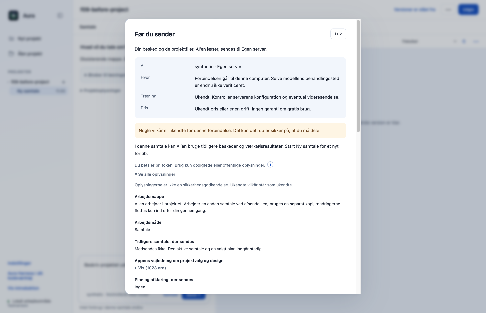
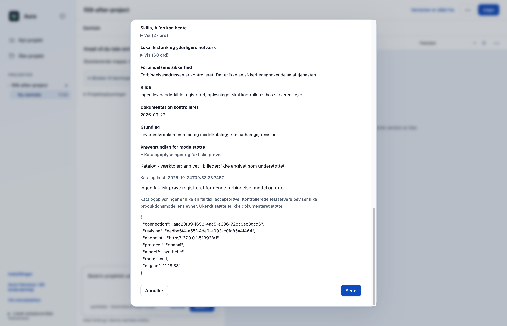
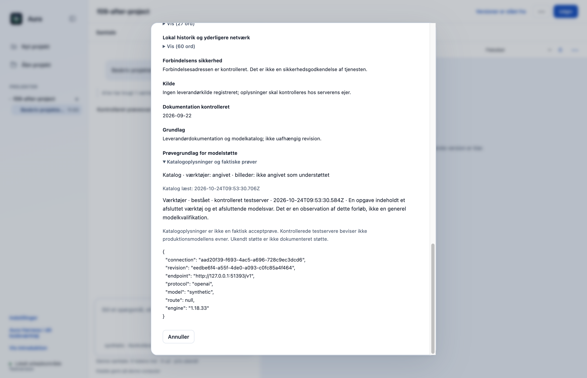

# F09: Skeln modelkatalogets oplysninger fra observeret værktøjsstøtte

Et modelkatalog kan angive værktøjs- eller billedstøtte uden at den valgte forbindelse og rute er afprøvet. PR’en viser katalogoplysninger og konkrete observationer separat og binder observationerne til modtager, model, rute, protokol, forbindelsesrevision og motorversion.

## Hvad ændres?

- Viser angivet, ikke understøttet og ukendt hver for sig i den eksisterende datagennemgang.
- Registrerer en begrænset værktøjsobservation, når en opgave indeholder et afsluttet værktøj og et afsluttende modelsvar uden fejl eller stop.
- Opbevarer højst 100 observationer i hukommelsen; gemmer metadata, ikke rå værktøjsresultater.
- Kontrollerede lokale testservere mærkes særskilt. Der startes ingen betalte modelprøver eller automatiske forbindelsesskift.
- Bevarer eksplicitte billedfelter for modeller og OpenRouter-ruter; ukendt rute behandles ikke som dokumenteret billedstøtte.

Når **Før du sender** vises, åbn **Se alle oplysninger** og fold **Katalogoplysninger og faktiske prøver** ud. Her kan du se katalogets angivelser og eventuelle observationer for den aktuelle forbindelse; visningen starter ikke en ny modelprøve.

## Før og efter

Før ses den eksisterende katalogbeskrivelse. Efter ses katalog og faktiske prøver hver for sig. Det sidste billede viser en faktisk registreret observation fra den kontrollerede lokale server.

| Før | Efter |
|---|---|
|  |  |

## Afprøvning

- 13 fokuserede prøver dækker præcis binding, ukendte/negative katalogfelter, ugyldige observationer, pakket core og faktiske HTTP-katalogsvar.
- Hændelsesprøver: afsluttet værktøj + svar giver observation; ingen værktøj, værktøjsfejl, manglende svar, motorfejl og stop giver ingen.
- Native app + faktisk OpenCode læser syntetisk fil gennem kontrolleret modelserver; den registrerede observation vises i den eksisterende dialog.
- Samlet desktopgate: **527/529 består**. De to fejl i `approvals.test.cjs` ved linje 47 og 74 findes også på uændret original `dce68ea`; der er ingen nye testfejl.
- CLI: **26/26 består**.

## Bevarelse og begrænsninger

Originalens navigation, onboarding, projekter, planer og værktøjsgodkendelser bevares. De viste tillæg til de eksisterende kontroller er særskilt godkendt. En gennemført opgave er kun en observation af netop det forløb, ikke generel modelkvalifikation. Produktionsudbydere er ikke afprøvet. Ingen syntetiske visionresultater indsættes som produktionsbevis; observationerne forsvinder ved genstart.

Prøvet lokalt på macOS Apple Silicon med Node 22.23.3 og Electron 44.4.4. Der er ikke brugt produktionskonti, startet GitHub Actions eller udgivet en ny DMG. T04 og F15 er derudover kontrolleret i lokale apppakker. Windows og Intel-Mac er ikke fysisk afprøvet. Originalens onboarding, planer og konkrete værktøjs-/datagodkendelser bevares.

[Måleresultat: native-report.json](f09-native-report.json).

## Genskab testene

Brug den låste Node 22.23.3-runtime. Kør `node --test --test-concurrency=1 desktop/tests/*.test.cjs` og `node --test cli/tests/*.test.cjs`. Nativebeviserne bruger Electron 44.4.4 og faktisk OpenCode 1.18.33 med syntetiske svar fra en kontrolleret lokal server.

## Review

Koden, de afgrænsede nye adfærdsveje og de faktiske appbilleder er gennemgået. Fund vedrørende kontekstbinding, pakket indlæsning, billedoverdragelse, PDF-hemmelighedskontrol og signering blev rettet og afprøvet før indsendelse. Screenshots viser syntetiske testdata.
