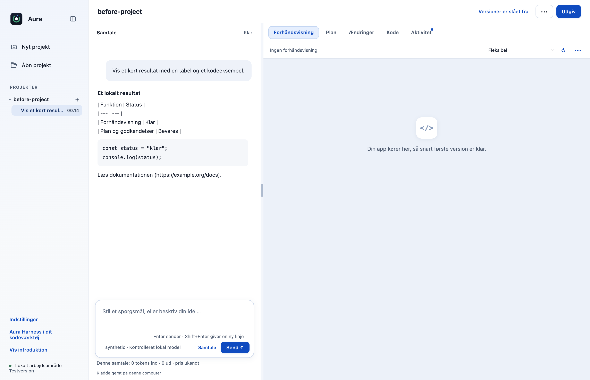
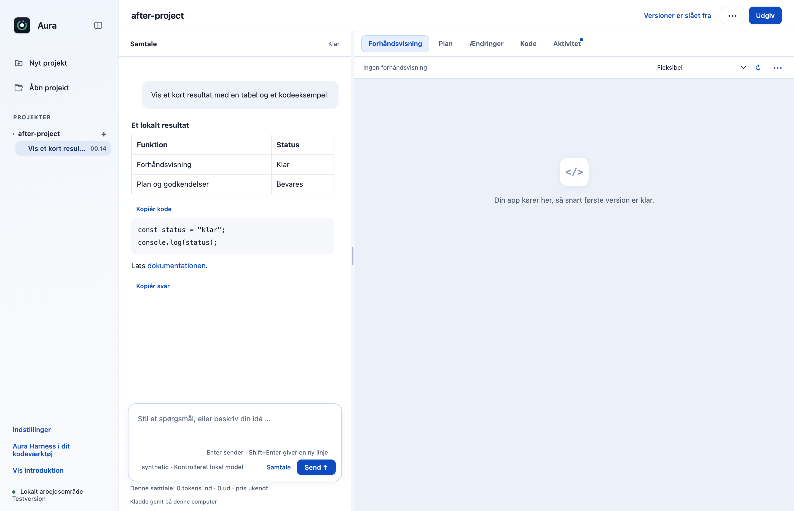
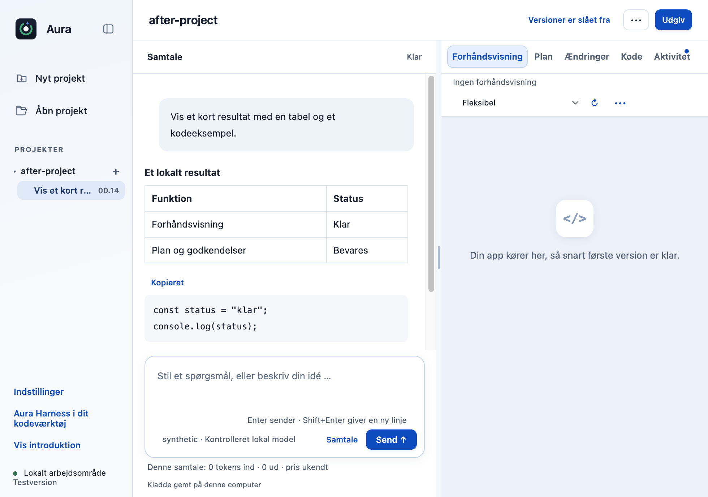

# F10: Gør AI-svar læsbare med tabeller, kopiering og sikre links

AI-svar med Markdown-tabeller vises i originalen som rå lodrette streger, kode skal markeres manuelt, og weblinks er ren tekst. Denne PR viser enkle tabeller, giver Kopiér kode og Kopiér svar i chatten og åbner udtrykkeligt valgte http(s)-links gennem en valideret handling i hovedprocessen.

## Hvad ændres?

- Den eksisterende tekstbaserede Markdown-visning flyttes til et lille modul og bevarer overskrifter, lister, kursiv, fed tekst, kode, streaming, farveprøver og projektfilhenvisninger.
- Enkle pipe-tabeller vises med kolonneoverskrifter og lokal rulning; escaped pipes og pipes i inlinekode behandles som celleindhold.
- Kopiering sker kun ved klik og bruger den oprindelige svar-/kodetekst. Kopiknapper tilføjes kun i chatsvar, så planpanelets eksisterende betjening bevares.
- Weblinks er knapper, der går gennem den eksisterende IPC-afsenderkontrol og en ny URL-validator i hovedprocessen. Fil-, kommando-, javascript- og dataadresser, loginoplysninger og kontroltegn afvises. Modeltekst fortolkes aldrig som HTML.

## Før og efter

Samme syntetiske svar sendes fra en kontrolleret lokal modelserver gennem den faktiske OpenCode-motor til originalen og PR-udgaven. Før vises tabellen som tekst; efter vises tabel, kode-/svarkopiering og et udtrykkeligt weblink. Det sidste billede viser et 980 × 720-vindue. Billederne er fra den rigtige Electron-app, ikke en mockup.

| Før | Efter |
|---|---|
|  |  |

## Afprøvning

- Nye testcases dækker inert HTML, tabeller, escaped/code pipes, opdateret streaming, eksisterende lister/overskrifter, eksplicitte klik, eksakt tekstkopiering samt blokering af usikre links i både renderer og hovedproces.
- Kodekopiering bevarer tomme linjer og bruger den oprindelige tekst, selv når visningen efterfølgende dekoreres med projektlinks/farveprøver.
- Native Workbench → OpenCode → lokal SSE-server: korrekt svarvisning, eksakt kopi af svar og kode samt ét korrekt link gennem rigtig IPC og URL-validering. En ekstra prøve i Chromiums faktiske DOM holder HTML i tabelceller inert.
- OS-udklipsholder og browseråbning blev erstattet med kontrollerede testmodtagere under prøven; brugerens udklipsholder og browser blev ikke ændret. Nul rendererfejl og nul Git-skrivninger.
- Gentag de automatiske prøver med `node --test --test-concurrency=1 desktop/tests/*.test.cjs` og `node --test --test-concurrency=1 cli/tests/*.test.cjs`.
- Samlet desktopgate: **518/520 består**. De to fejl i `approvals.test.cjs` ved linje47 og74 findes også på uændret original `dce68ea`; der er ingen nye testfejl.
- CLI: **26/26 består**.

## Bevarelse og begrænsninger

Dette er en bevidst lille Markdown-visning, ikke en fuld CommonMark/GFM-parser; komplekse indlejrede tabeller og alle Markdown-linkvarianter er ikke understøttet. Et tilladt http(s)-link er ikke en garanti for destinationssidens troværdighed. De faktiske systemhandlinger til udklipsholder og standardbrowser er afgrænset ved testmodtagere; native prøve verificerer brugerhandling, indhold og IPC/validering, ikke OS-programstart.

Prøvet lokalt på macOS Apple Silicon med Node22.23.3 og Electron44.4.4. Der er ikke brugt produktionskonti, startet GitHub Actions eller lavet en ny installationspakke. Windows og Intel-Mac er ikke fysisk afprøvet. Originalens onboarding, planer og konkrete værktøjs-/datagodkendelser bevares.
