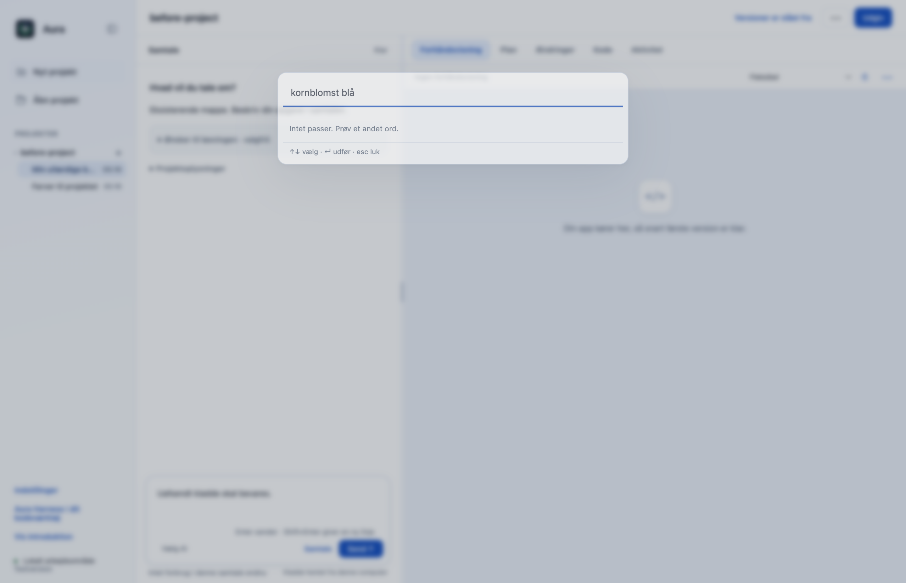
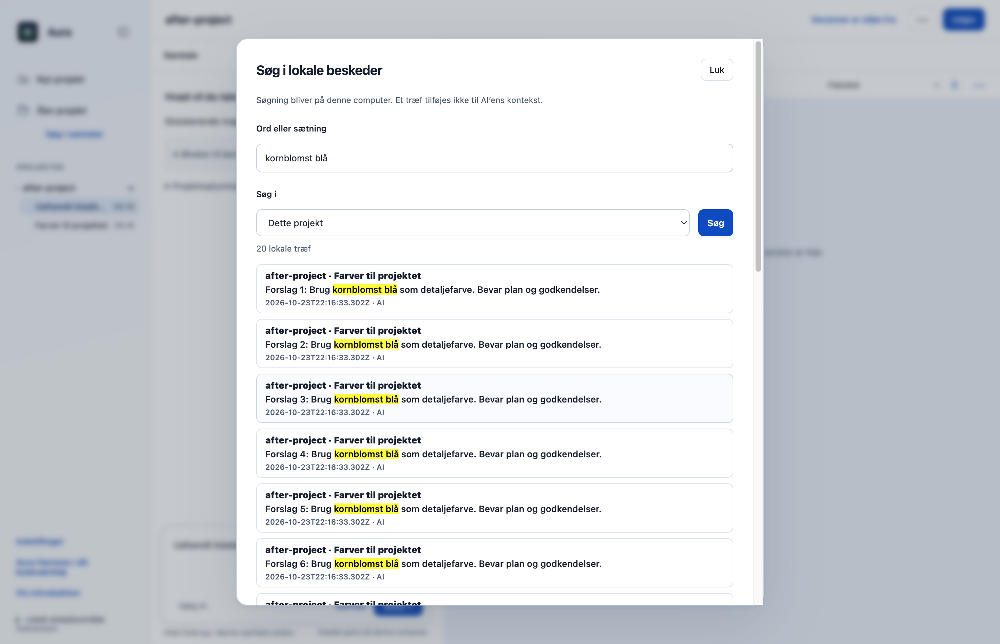
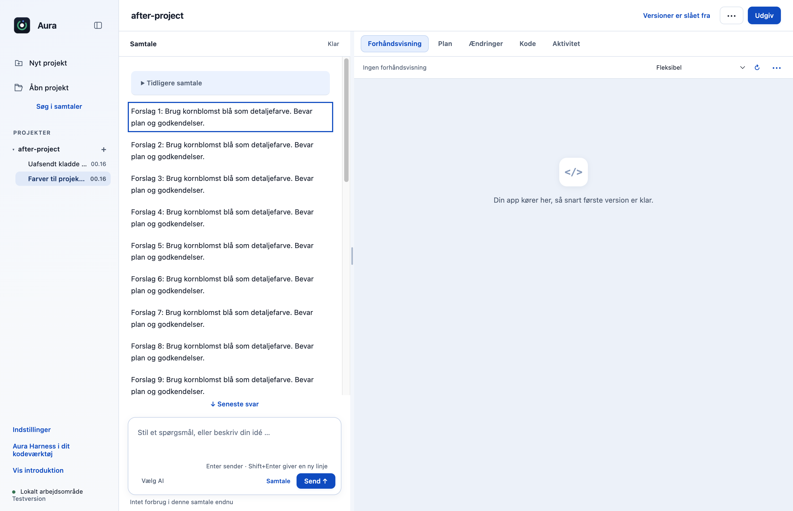
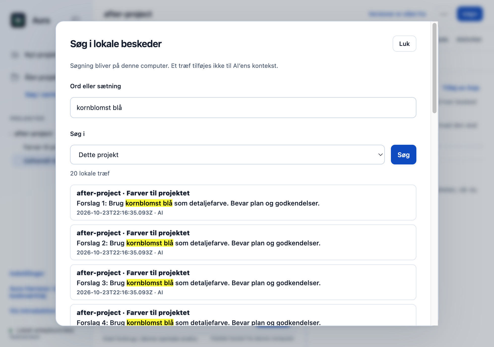

# F11: Søg lokalt i samtalernes beskeder og åbn det præcise træf

Originalens kommandopalette finder projekter og samtaletitler, men ikke ord inde i beskederne. Søg i samtaler tilføjer en lokal beskedsøgning med afgrænsning til dette projekt, denne samtale eller alle kendte lokale projekter. Et klik åbner den præcise gemte besked og bevarer chatkladden.

## Hvad ændres?

- Den eksisterende kommandopalette og projektnavigation bevares. Den nye søgeknap bruger en dialog i originalens eksisterende stil.
- Søgningen læser kun indekserede samtalefiler i appens eget lager; ingen projektkildefiler, modeller, eksterne tjenester, historikmigrationer eller nye datatilladelser.
- Faste grænser afgrænser projekter, samtaler, filstørrelser, samlet faktisk læsning og resultatsider. Symlinks, hardlinks, ændrede, for store og beskadigede records springes over. Læste bytes tæller også ved korrupt JSON.
- Resultater viser lokale tekstuddrag og præcise besked-IDer. Kladder gemmes før navigation, og en nødvendig genindlæsning i samme samtale opdaterer kun beskederne; en usendt plan-/briefredigering nulstilles ikke.
- Søgning og træf indgår ikke i skrivefelt, historiktilvalg, modelkontekst, planer eller værktøjsgodkendelser. Escape lukker søgedialogen; forældede søgesvar ignoreres.

## Før og efter

Før: den faktiske originale kommandopalette finder ikke kornblomst blå, som kun står i beskederne. Efter: den nye lokale søgning finder beskederne og åbner den præcise gemte besked. Samme syntetiske samtaledata bruges i begge native appprøver. Der vises også præcis navigation og et 980 × 720-vindue.

| Før | Efter |
|---|---|
|  |  |

## Afprøvning

- Automatiske testcases: søgning i beskedtekst uden skrivning, projekts-/samtalefiltre, pagination, ukendte IDer, korrupte og store records, symlinkede filer/mapper og legacy-historik uden migration.
- Seks korrupte 8 MiB-filer afprøves med måling af faktisk læste bytes; samlet læsning holder sig under 32 MiB-budgettet.
- Den faktiske navigationsfunktion afprøves med en nyligt gemt besked uden DOM-ID. Genindlæsningen må ikke kalde fillChat eller nulstille plan-/briefredigering; en arbejdende samtale genopbygges ikke.
- Native prøve: 20 og derefter 25 lokale træf, præcis besked m0, gemt og gendannet ufærdig kladde, bevaret usendt briefredigering i samme samtale, nul træf, Escape og smalt vindue uden vandret side-overflow.
- Nul modelkald, nul rendererfejl og nul Git-skrivninger i den native prøve. Resultatet blev ikke valgt som ekstra historik til AI.
- Gentag prøverne med `node --test --test-concurrency=1 desktop/tests/*.test.cjs` og `node --test --test-concurrency=1 cli/tests/*.test.cjs`.
- Samlet desktopgate: **521/523 består**. De to fejl i `approvals.test.cjs` ved linje47 og74 findes også på uændret original `dce68ea`; der er ingen nye testfejl.
- CLI: **26/26 består**.

## Bevarelse og begrænsninger

Der søges kun i den historik, Aura faktisk har bevaret; allerede frasorterede gamle beskeder kan ikke genfindes. Faste grænser er 100 projekter, 500 samtaler, 512 KiB pr. indeks, 8 MiB pr. samtalefil og 32 MiB samlet faktisk læsning. Et gammelt format skal først åbnes og migreres gennem den eksisterende projektfunktion. Begrænset eller utilgængelig historik oplyses i søgestatus. Store biblioteker kan derfor kræve en snævrere søgning. Ingen ny historikindeksering eller baggrundstjeneste indføres. Der søges højst i de første 30.000 tegn af hver gemt besked.

Prøvet lokalt på macOS Apple Silicon med Node22.23.3 og Electron44.4.4. Der er ikke brugt produktionskonti, startet GitHub Actions eller lavet en ny installationspakke. Windows og Intel-Mac er ikke fysisk afprøvet. Originalens onboarding, planer og konkrete værktøjs-/datagodkendelser bevares.
