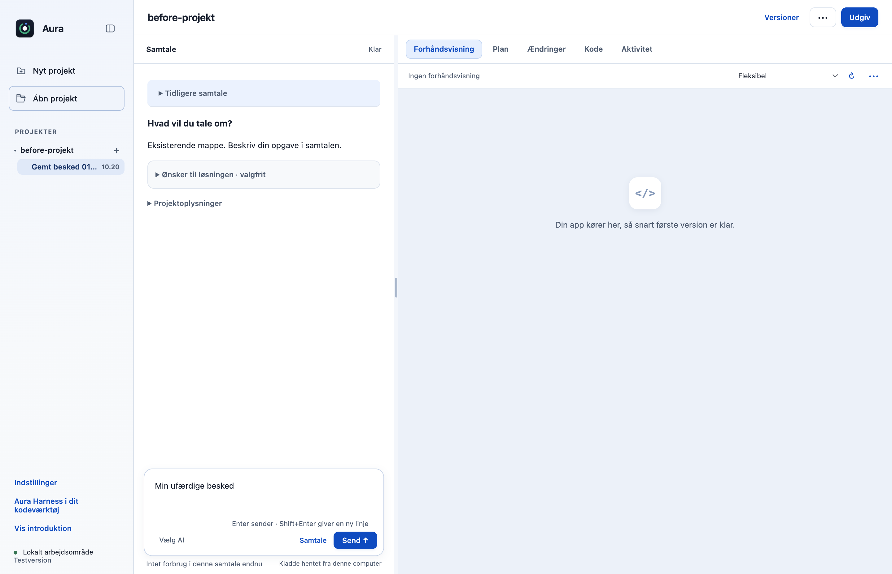
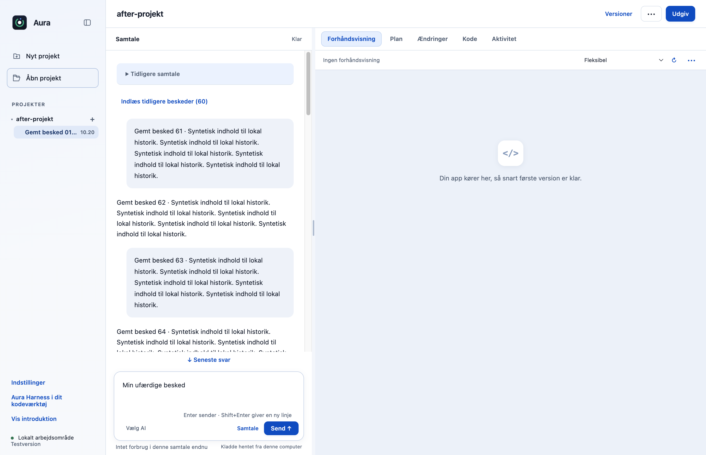
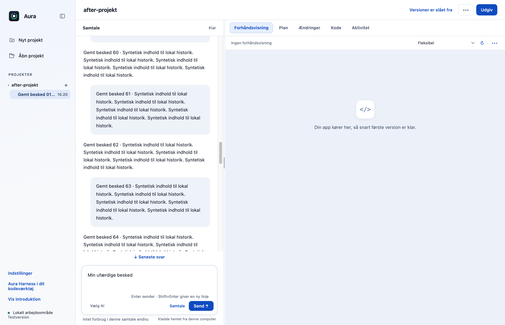

# Indlæs tidligere gemte beskeder med en diskret knap (F12)

Lange gemte samtaler viser først den seneste del. Brugeren kan hente flere tidligere beskeder med en diskret knap over samtalen, uden at starte en AI-opgave eller ændre den kladde, plan og arbejdsform, der allerede er valgt.

## Hvad ændres?

- Tilføjer den godkendte tidligere-beskeder-knap og en kort status. Ved åbning vises højst 20 beskeder og normalt 60.000 tegn; yderligere beskeder indlæses i tilsvarende sider.
- Indsætter hele beskeder i oprindelig rækkefølge og bevarer læsepositionen, når ældre indhold lægges til øverst. Eksisterende samtaleposter ændres ikke.
- Visningsindlæsning er adskilt fra at sende ældre historik til modellen. Den eksisterende resume-/kontekstadvarsel og dens konkrete datagodkendelse bevares.
- Kladde, plan og valgt Planlæg/Arbejd direkte-tilstand bevares; knappen foretager hverken modelkald eller værktøjshandlinger.

## Før og efter

Før: originalen tegner den gemte samtale samlet. Efter: den faktiske Electron-app viser seneste side med en diskret knap til ældre beskeder. Det tredje billede viser tidligere beskeder efter indlæsning. Samme syntetiske samtale, kladde og plan er brugt før/efter.

| Før | Efter |
|---|---|
|  |  |

## Afprøvning

- Tre fokuserede visningsprøver består: op til 200 poster, komplet rækkefølge uden dubletter, tom historik, Unicode, store enkeltbeskeder og uændrede originale poster.
- Native Electron-prøve med 80 faktisk gemte beskeder: 20 → 40 → 80 vises i korrekt rækkefølge. Ingen HTTP-/modelkald, dubletter eller ændret kladde, plan eller arbejdsform.
- Genindlæsning viser igen seneste side og bevarer den gemte kladde. Ingen rendererfejl eller Git-skrivninger.
- Samlet desktopgate: **517/519 består**. De to fejl i `approvals.test.cjs` ved linje47 og74 findes også på uændret original `dce68ea`; der er ingen nye testfejl.
- CLI: **26/26 består**.

## Bevarelse og begrænsninger

Kun beskeder, som originalens eksisterende lager stadig har bevaret, kan indlæses. Originalens opbevaringsloft på 200 beskeder/200.000 tegn ændres ikke, og allerede bortskåret historik genskabes ikke. En enkelt ældre besked over visningsgrænsen vises hel, så tekst ikke afkortes. Funktionen komprimerer ikke modellen og ændrer ikke sessionshukommelsen eller datatilladelser.

Prøvet lokalt på macOS Apple Silicon med Node22.23.3 og Electron44.4.4. Der er ikke brugt produktionskonti, startet GitHub Actions eller lavet en ny installationspakke. Windows og Intel-Mac er ikke fysisk afprøvet. Originalens onboarding, planer og konkrete værktøjs-/datagodkendelser bevares.

[Måleresultat: native-report.json](f12-native-report.json).
