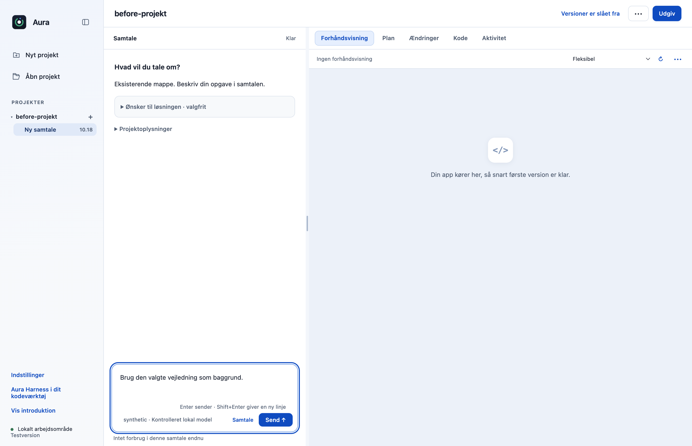
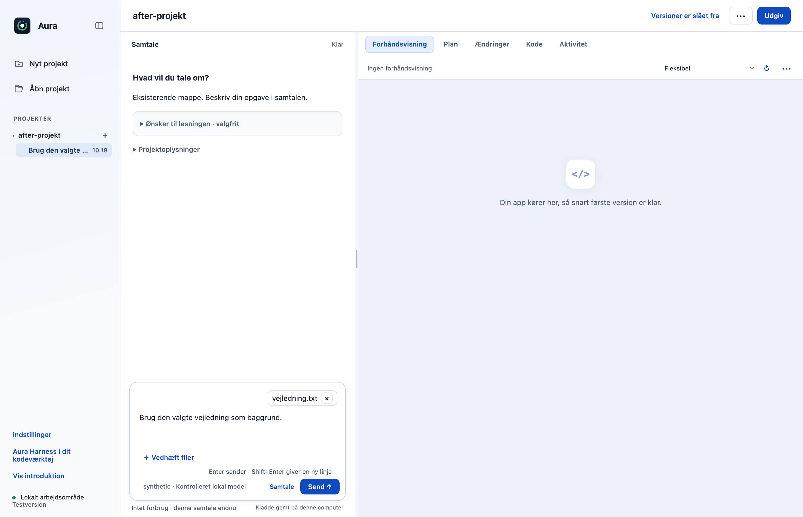
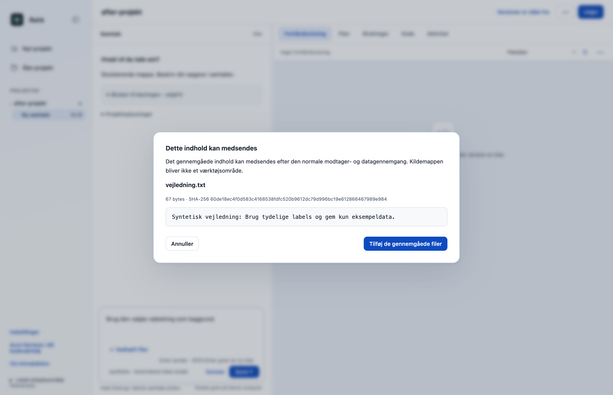
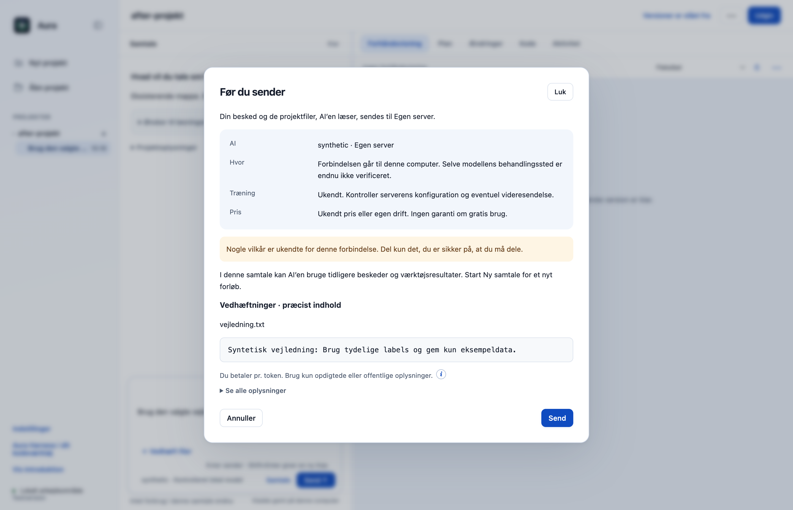
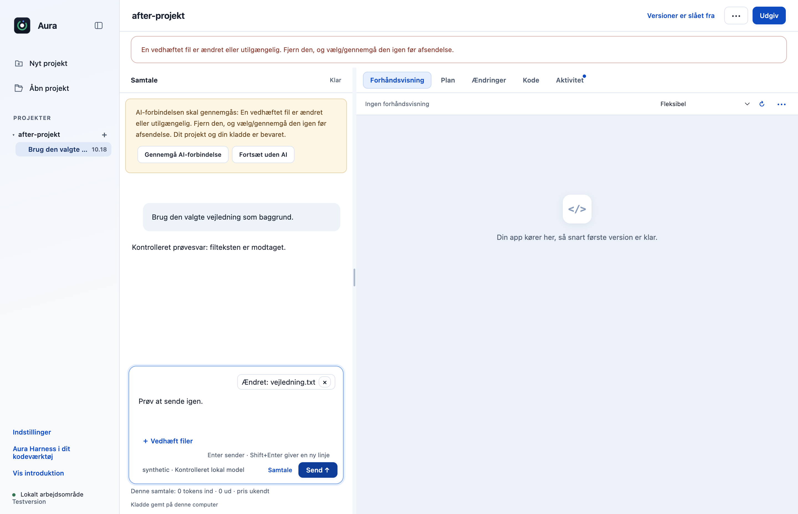
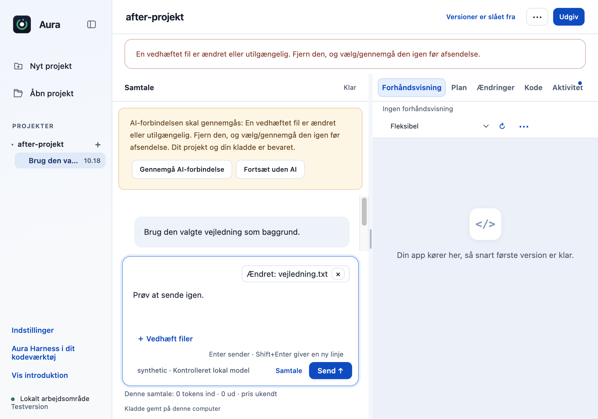

# Vedhæft gennemgåede tekstfiler direkte i samtalen (F13)

Brugeren kan vælge tekst- eller kodefiler fra computeren direkte i samtalen, gennemgå deres præcise tekst og medtage det valgte indhold i et konkret AI-kald. Filstier bliver i hovedprocessen; kildemappen bliver ikke et arbejdsområde for agenten. Den eksisterende modtagergennemgang, modelvalg, plan og værktøjsgodkendelser bevares.

Vælg **Vedhæft filer** under skrivefeltet, og vælg filer i computerens filvælger. Kontrollér udvalget, vælg **Gennemgå indhold**, og tilføj de gennemgåede filer. Når beskeden sendes, vises det præcise filindhold igen sammen med modtageren; først den konkrete godkendelse tillader afsendelsen.

## Hvad ændres?

- Tilføjer den godkendte, diskrete Vedhæft filer-knap, fjernbare filvalg og en læsbar gennemgang af det præcise UTF-8-indhold før tilføjelse. Ingen ny navigation eller onboarding.
- Native filvalg udsteder uigennemsigtige id’er bundet til projekt og samtale. Renderer og model kan ikke angive en vilkårlig filsti.
- Højst otte filer, 128 KB pr. fil og 384 KB samlet. Skjulte, beskyttede og genererede filer, symbolske links, binære data og genkendelige nøgler/adgangskoder afvises. Dette er ikke en fuld persondataklassifikation.
- Filindhold og modtager bindes til samme forberedte engangsafsendelse. SHA-256 og filidentitet kontrolleres ved gennemgang, tilføjelse, forberedelse og umiddelbart efter asynkron opstart før engine.send. Ændringer kræver nyt filvalg og ny gennemgang.
- Vedhæftninger ændrer ikke AI’ens værktøjsrettigheder eller genstarter dens ellers uændrede modelsession. Et forsøg på at genbruge samme filgodkendelse afvises.

## Før og efter

Før: samtalen har projektets egne filhenvisninger, men ingen direkte chatvedhæftninger fra computeren. Efter: en diskret knap under skrivefeltet, valgte filer og en separat indholdsgennemgang. De ekstra billeder viser det præcise materiale ved modtagergodkendelse, en ændret fil der afvises og en smal visning. Alle billeder er taget i den faktiske Electron-app med udelukkende syntetiske data.

| Før | Efter |
|---|---|
|  |  |

## Afprøvning

- 18 fokuserede fil-, IPC- og Workbench-prøver består, inklusive stiforfalskning, stale scope, byteændring, symlink, størrelse, UTF-8, engangsgodkendelse, kopiallokering og ændret forbindelse under opstart.
- Native Electron-prøve gennem den rigtige OpenCode 1.18.33 og en kontrolleret lokal SSE-server: præcis gennemgået tekst modtages, absolut kildefilsti medsendes ikke, og en efterfølgende ændret fil giver intet nyt modelkald. AI-svaret er en syntetisk testrespons.
- Kladden bevares ved afvist filændring; et renderer-forsøg på selv at levere filsti afvises. Ingen rendererfejl eller Git-skrivninger. Responsiv visning er afprøvet ved 980×720.
- Native Escape-regression med forsinket fillæsning: den igangværende vedhæftning kan ikke skjules ved at lukke dialogen; præcis én tilføjelse og ingen rendererfejl.
- Samlet desktopgate: **532/534 består**. De to fejl i `approvals.test.cjs` ved linje47 og74 findes også på uændret original `dce68ea`; der er ingen nye testfejl.
- CLI: **26/26 består**.

## Bevarelse og begrænsninger

Kun almindelig UTF-8-tekst/kode; PDF, billeder/OCR, vedvarende filvalg og hele mapper er ikke en del af F13. Ingen påstand om fuld Privacy Gate eller OS-sandbox. Fjernelse af et aktuelt filvalg sletter ikke tekst, som allerede findes i AI’ens samtalehistorik. Kilderne ændres ikke, og ingen skriveadgang eller nye værktøjstilladelser gives. Originalens andre filhenvisninger og referencer fungerer fortsat.

Prøvet lokalt på macOS Apple Silicon med Node22.23.3 og Electron44.4.4. Der er ikke brugt produktionskonti, startet GitHub Actions eller lavet en ny installationspakke. Windows og Intel-Mac er ikke fysisk afprøvet. Originalens onboarding, planer og konkrete værktøjs-/datagodkendelser bevares.

[Måleresultat: native-report.json](f13-native-report.json).

[Måleresultat: native-cancel-report.json](f13-native-cancel-report.json).
