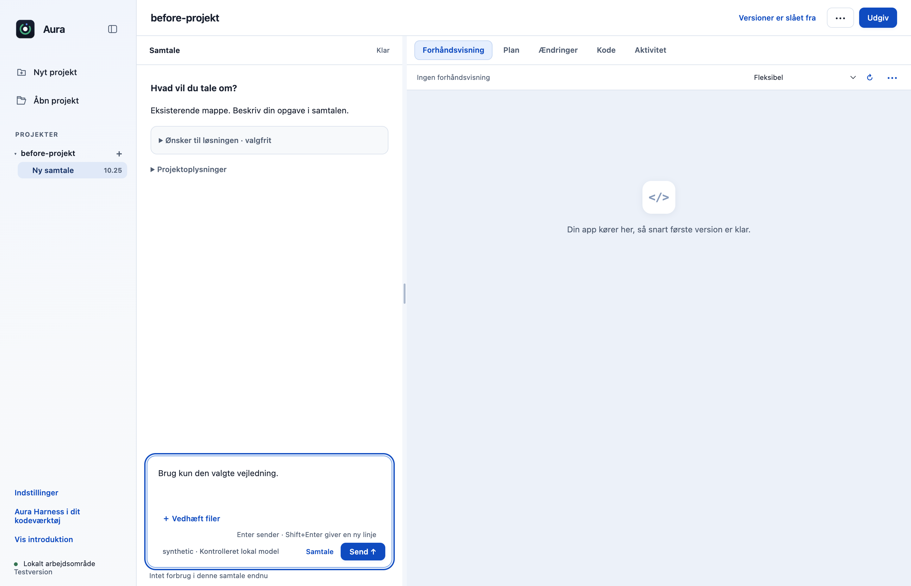
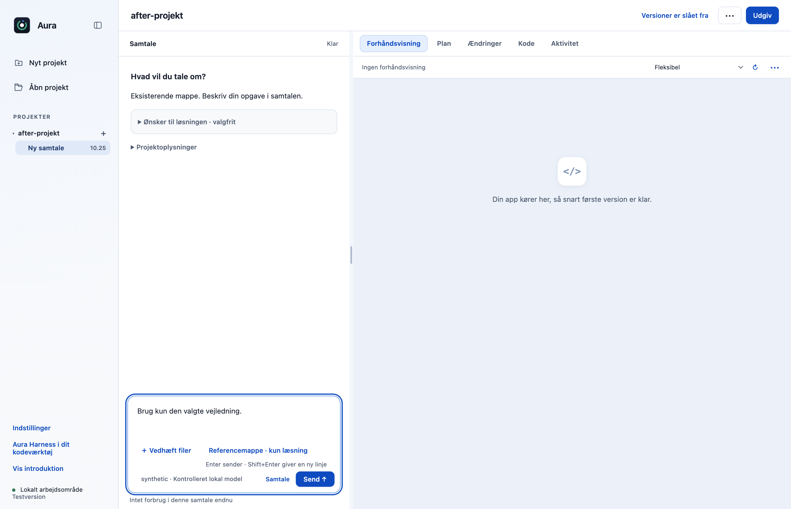
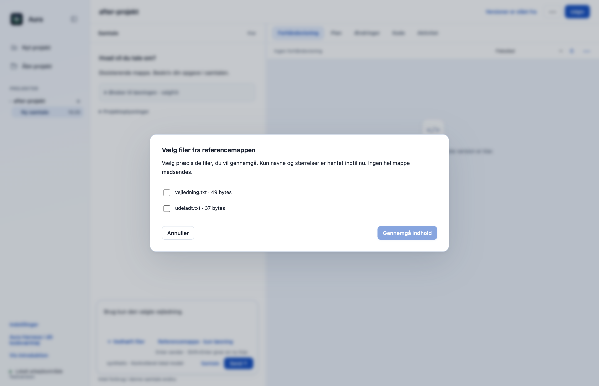
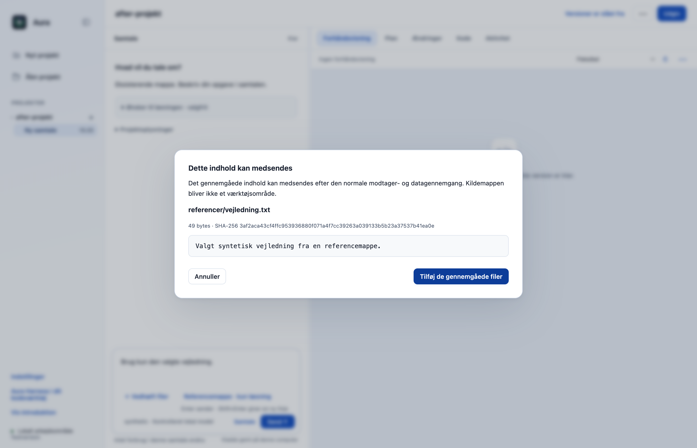

# Brug udvalgte filer fra referencemapper som læsekontekst (F14)

Brugeren kan vælge en ekstra referencemappe, se en afgrænset liste over egnede tekstfiler og derefter gennemgå og vedhæfte netop de filer, der skal bruges i samtalen. Valget giver ikke agenten generel adgang til mappen eller lov til at ændre den. **Afhænger af F13 (#29); gennemgå og flet F13 først.**

Vælg **Referencemappe · kun læsning** under skrivefeltet, og vælg én konkret mappe i computerens mappevælger. Markér de ønskede filer i listen, vælg **Gennemgå indhold**, og tilføj dem efter gennemlæsning. Det præcise indhold gennemgås igen sammen med modtageren, når beskeden sendes; valg af mappen alene giver ingen delingstilladelse.

## Hvad ændres?

- Tilføjer den godkendte Referencemappe · kun læsning-knap ved filvedhæftning. Ingen fil er forhåndsvalgt; hvert valg og det præcise tekstindhold gennemgås særskilt.
- Native mappevalg og hovedprocessens metadataopslag er bundet til aktivt projekt og samtale. Renderer kan ikke udpege en vilkårlig mappe eller genbruge et gammelt mappevalg efter projektskift.
- Højst 250 mappeposter, 100 kandidater og tre undermappeniveauer. Rod-, hjemme- og systemmapper, skjulte/genererede filer og symbolske links bliver ikke en genvej til ubegrænset filadgang.
- Valgte filer bruger F13’s grænser, eksakte snapshots og konkrete engangsafsendelse. Ikke-valgte filer læses ikke som modelmateriale, og referencemappen bliver ikke et skriveområde.

## Før og efter

Førbilledet er F13; efterbilledet isolerer derfor kun F14’s mappeknap. De ekstra faktiske Electron-billeder viser en mappe med fravalgte kandidater og gennemgang af det konkrete valgte indhold. Syntetiske prøvedata; ingen personoplysninger.

| Før | Efter |
|---|---|
|  |  |

## Afprøvning

- 24 fokuserede fil-, mappe-, IPC- og Workbench-prøver består: eksplicit delmængde, brede mapper, dybde, symlink-udskiftning og projektskift under native mappevalg.
- Native Electron-prøve med rigtig OpenCode 1.18.33 og kontrolleret lokal SSE-server: kun præcis tekst fra den valgte fil sendes. Tekst fra fravalgt fil og absolut kildefolder sendes ikke; kildefiler er uændrede.
- Mappevalg er uden forhåndsmarkering. Ingen rendererfejl eller Git-skrivninger.
- Samlet desktopgate: **538/540 består**. De to fejl i `approvals.test.cjs` ved linje47 og74 findes også på uændret original `dce68ea`; der er ingen nye testfejl.
- CLI: **26/26 består**.

## Bevarelse og begrænsninger

Afhængig PR: diffen mod originalens main indeholder F13, indtil #29 er flettet og denne branch kan opdateres. F14’s særskilte ændring er mappeopslag, eksplicit kandidatudvalg og mappeknappen; førbilledet viser F13. Kun egnede UTF-8-tekstfiler inden for F13’s grænser, ikke PDF/OCR, overvågning, indeksering eller vedvarende mappeadgang. Ingen fuld Privacy Gate eller OS-sandbox. Fjernelse af et aktuelt filvalg fjerner ikke allerede delt tekst fra AI-historik. Plan- og værktøjsgodkendelser giver fortsat kun de normale projektrettigheder.

Prøvet lokalt på macOS Apple Silicon med Node22.23.3 og Electron44.4.4. Der er ikke brugt produktionskonti, startet GitHub Actions eller lavet en ny installationspakke. Windows og Intel-Mac er ikke fysisk afprøvet. Originalens onboarding, planer og konkrete værktøjs-/datagodkendelser bevares.

[Måleresultat: native-report.json](f14-native-report.json).
