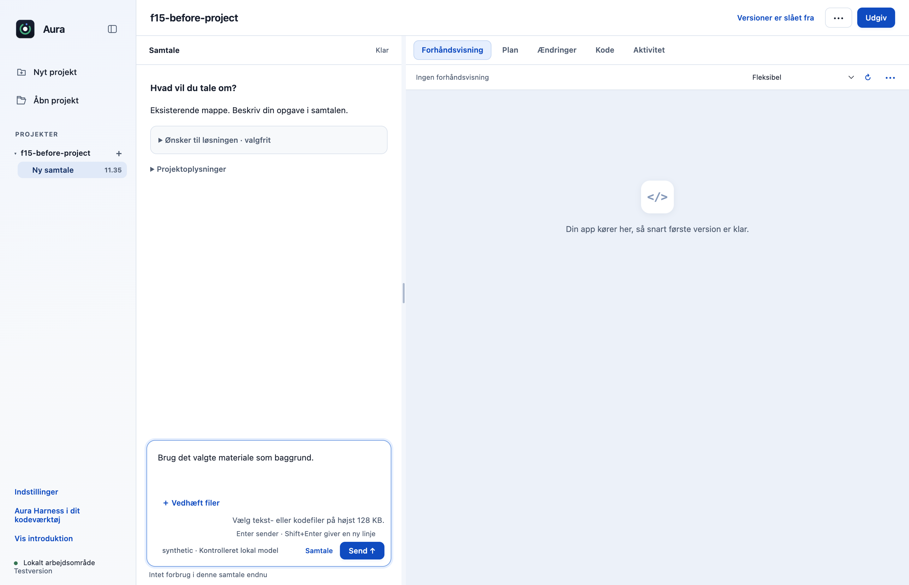
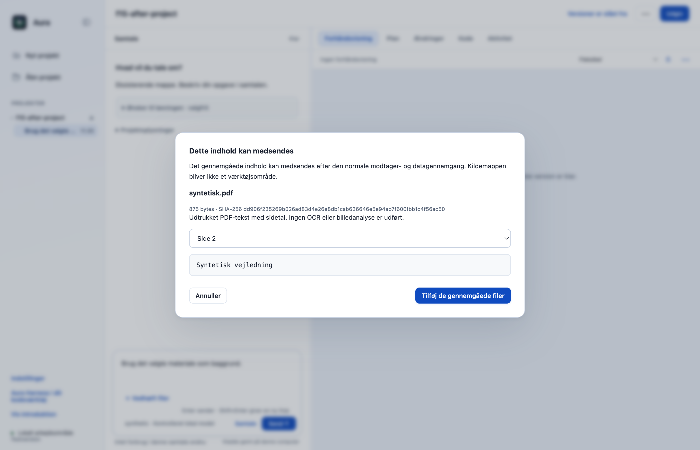
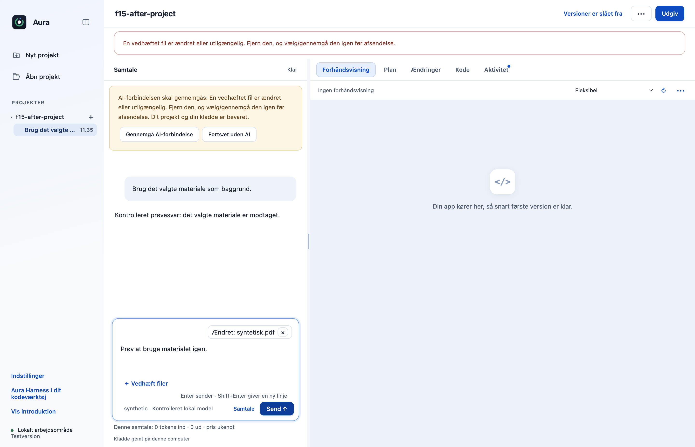
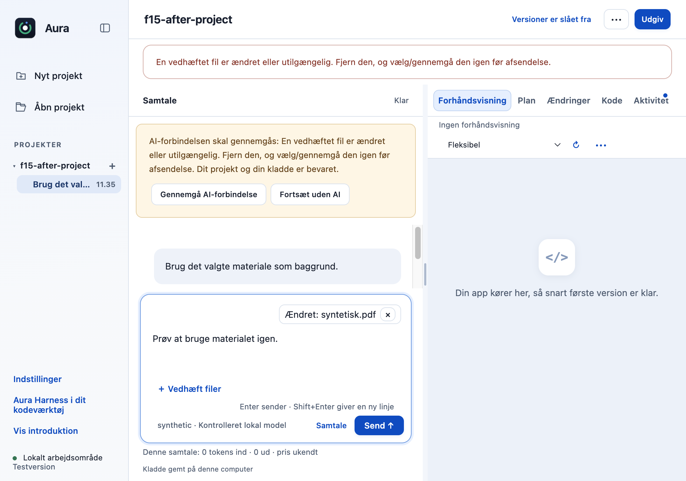

# F15: Gennemgå lokalt udtrukket PDF-tekst før deling i chatten

PDF’er kan ikke bruges som gennemgået chatmateriale i den eksisterende filvej. PR’en udtrækker afgrænset tekst lokalt, viser siderne til gennemgang og sender den gennemgåede udtrukne tekst med sidemarkeringer. Originale PDF-bytes og kildestier medsendes ikke.

## Hvad ændres?

- Bruger låst pdfjs-dist 6.4.299 (Apache-2.0) i en separat lokal Node-proces. Nye afhængigheder og integriteter står i lockfilen.
- Afgrænser til 5 MB, 100 sider, 128 KiB tekst, 256 MB worker-heap, 1 MB procesoutput og 15 sekunders tidsfrist.
- Ingen OCR, netværkshentning, PDF-JavaScript, eksterne URL’er eller billede-rendering i ekstraktionsvejen.
- PDF-tekst går gennem samme hemmelighedskontrol som tekstfiler. Kildehash, sider og udtrukket tekst bindes til gennemgangen.
- Pakket worker og afhængigheder ligger korrekt uden for ASAR; bruger medfølgende Node.

Vælg **Vedhæft filer**, vælg PDF’en, og tryk **Gennemgå indhold**. Brug **Vælg PDF-side** til at læse siderne, og vælg derefter **Tilføj de gennemgåede filer** før den konkrete afsendelse. Sidevælgeren skifter kun den viste side; alle sider i den gennemgåede udtrukne tekst medsendes med sidemarkeringer, og der er ikke valg af enkelte sider til deling.

## Før og efter

Før afvises PDF-formatet. Efter kan brugeren gennemgå den lokalt udtrukne tekst side for side før deling. De øvrige billeder viser ændringsværnet og den smalle visning.

| Før | Efter |
|---|---|
|  |  |

## Afprøvning

- Faktisk PDF.js-ekstraktion af syntetisk flersidet PDF, ugyldig/textless/for stor PDF, kildeændring og samme hemmelighedsværn for TXT/PDF.
- Workerens tidsfrist og unormale afslutning medfører afvisning.
- Native app + OpenCode mod kontrolleret server: præcis gennemgået tekst, ingen PDF-bytes/kildesti, kildeændring blokerer næste afsendelse.
- Faktisk pakket app med begrænset PATH udtrækker to syntetiske sider gennem den medfølgende worker og Node. Pakkens kilde-/runtimebevis består.
- Samlet desktopgate: **567/569 består**. De to fejl i `approvals.test.cjs` ved linje 47 og 74 findes også på uændret original `dce68ea`; der er ingen nye testfejl.
- CLI: **26/26 består**.

## Bevarelse og begrænsninger

Originalens navigation, onboarding, projekter, planer og værktøjsgodkendelser bevares. De viste tillæg til de eksisterende kontroller er særskilt godkendt. Afhænger af F16, F09, F13 (#29) og T04. Den separate worker er afgrænset, men er ikke en fuld OS-sandbox. Ingen OCR, layoutrekonstruktion eller garanti for korrekt tekst fra enhver PDF; brugeren skal gennemgå teksten. Ingen ekstern produktionsmodel er afprøvet.

Prøvet lokalt på macOS Apple Silicon med Node 22.23.3 og Electron 44.4.4. Der er ikke brugt produktionskonti, startet GitHub Actions eller udgivet en ny DMG. T04 og F15 er derudover kontrolleret i lokale apppakker. Windows og Intel-Mac er ikke fysisk afprøvet. Originalens onboarding, planer og konkrete værktøjs-/datagodkendelser bevares.

[Måleresultat: native-report.json](f15-native-report.json).

[Måleresultat: packaged-worker.json](f15-packaged-worker.json).

[Måleresultat: package-proof.json](f15-package-proof.json).

Pakkebeviset angiver produktcommitten fra pakkeprøven. Senere ændringer i `README.md` og `docs/` ændrer ikke de kontrollerede produktfiler.

## Genskab testene

Brug den låste Node 22.23.3-runtime. Kør `node --test --test-concurrency=1 desktop/tests/*.test.cjs` og `node --test cli/tests/*.test.cjs`. Nativebeviserne bruger Electron 44.4.4 og faktisk OpenCode 1.18.33 med syntetiske svar fra en kontrolleret lokal server.

## Afhængigheder og afgrænsning

Forudsætninger: F13 #29, F09, F16, T04. De er endnu ikke flettet i main, så GitHubs samlede main-diff indeholder også forudsætningerne. Flet dem først og opdatér derefter denne branch; den ønskede nye funktion er afgrænset ovenfor.

[Ændringer siden funktionens forberedte grundlag](https://github.com/Parthee-Vijaya/ai-harness/compare/42309e6fc14db449ce82abfc3e0d9146dc66a626...303999786530992f2db1e9614e7a6a54a4e483f3). Dette sammenligningslink omfatter også senere rettelser til forudsætningerne.

## Review

Koden, de afgrænsede nye adfærdsveje og de faktiske appbilleder er gennemgået. Fund vedrørende kontekstbinding, pakket indlæsning, billedoverdragelse, PDF-hemmelighedskontrol og signering blev rettet og afprøvet før indsendelse. Screenshots viser syntetiske testdata.
