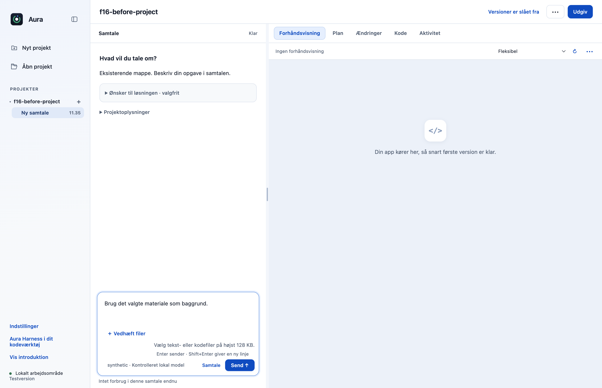
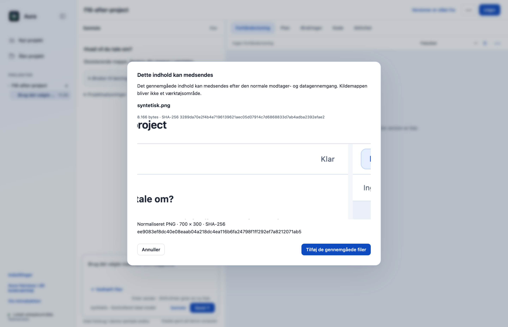
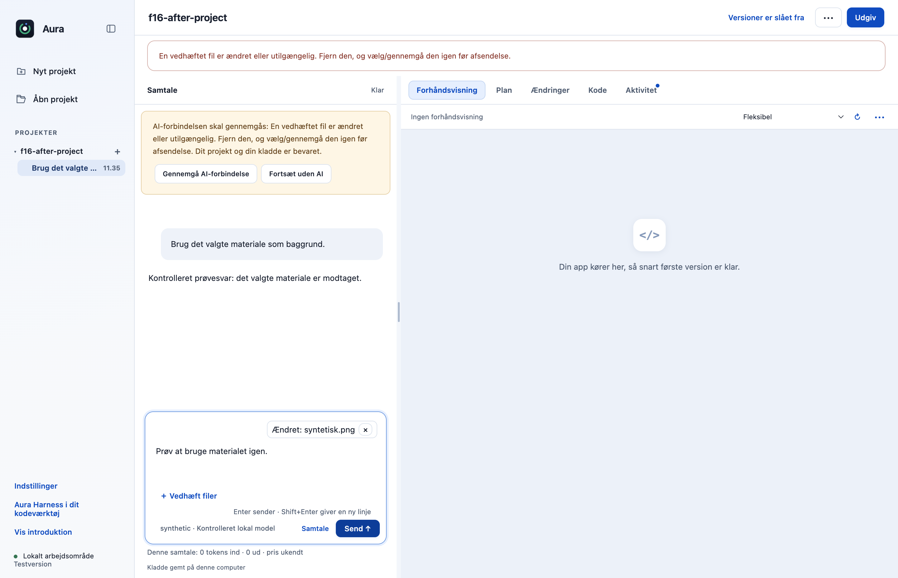
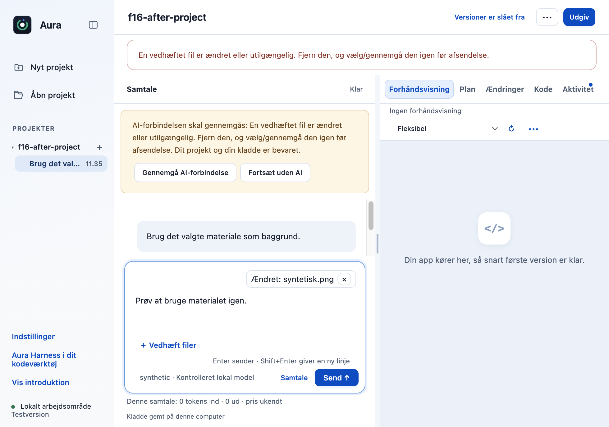

# F16: Vedhæft gennemgåede PNG- og JPEG-billeder i chatten

Chatmateriale accepterer i dag tekstfiler. PR’en udvider den gennemgåede vedhæftningsvej med PNG/JPEG, så brugeren ser det normaliserede billede før afsendelse. Gatewayen sender kun de gennemgåede pixeldata til en model og eventuel rute med eksplicit billedstøtte.

## Hvad ændres?

- Native filvalg og main-process-behandling: højst 5 MB kildefil, 8192 pixels pr. side og 24 megapixels; højst 1 MB normaliseret PNG pr. billede/4 MB samlet.
- Afkoder og genkoder billedet, fjerner kilde-metadata og binder både originalens og resultatets SHA-256 til gennemgangen.
- Afviser ændrede kilder, ukendt billedstøtte og manipulerede rendereroplysninger. Kildemappen bliver ikke et værktøjsområde.
- Indsætter billeder gennem Responses-, Anthropic-, Mistral- og kompatibel chat-adapter; afventer materialekontrol og medsender ikke ventende billeder ved komprimering.

Vælg **Vedhæft filer**, vælg PNG/JPEG, og tryk **Gennemgå indhold**. Kontrollér det viste normaliserede billede, vælg **Tilføj de gennemgåede filer**, og gennemgå den konkrete afsendelse; ukendt eller manglende billedstøtte blokerer billedafsendelsen.

## Før og efter

Sammenligningen bruger F13 som før-grundlag: billedfilen afvises før, og samme syntetiske billede kan gennemgås efter. De ekstra billeder viser ændringsværnet og smal visning.

| Før | Efter |
|---|---|
|  |  |

## Afprøvning

- Unit- og faktiske HTTP-adapterprøver dækker format, størrelsesgrænser, manipuleret input, ændrede kilder, model/rute og nulstilling mellem opgaver.
- Komprimeringsprøve bekræfter nul ventende billeder ved opsummering og ét ved den efterfølgende godkendte afsendelse.
- Native Electron + OpenCode mod kontrolleret server: gennemgået normaliseret billede i faktisk forespørgsel, ingen rå kildesti, ændring blokerer næste afsendelse og kladde bevares.
- 980-pixels visning og renderer kontrolleret uden nye fejl.
- Samlet desktopgate: **550/552 består**. De to fejl i `approvals.test.cjs` ved linje 47 og 74 findes også på uændret original `dce68ea`; der er ingen nye testfejl.
- CLI: **26/26 består**.

## Bevarelse og begrænsninger

Originalens navigation, onboarding, projekter, planer og værktøjsgodkendelser bevares. De viste tillæg til de eksisterende kontroller er særskilt godkendt. Afhænger af F13 (#29) og F09. Billedets synlige indhold sendes til den valgte AI efter gennemgangen; dette er ikke OCR, anonymisering eller fuld Privacy Gate. Billedstøtte fra en rigtig produktionsmodel er ikke kvalificeret.

Prøvet lokalt på macOS Apple Silicon med Node 22.23.3 og Electron 44.4.4. Der er ikke brugt produktionskonti, startet GitHub Actions eller udgivet en ny DMG. T04 og F15 er derudover kontrolleret i lokale apppakker. Windows og Intel-Mac er ikke fysisk afprøvet. Originalens onboarding, planer og konkrete værktøjs-/datagodkendelser bevares.

[Måleresultat: native-report.json](f16-native-report.json).

## Genskab testene

Brug den låste Node 22.23.3-runtime. Kør `node --test --test-concurrency=1 desktop/tests/*.test.cjs` og `node --test cli/tests/*.test.cjs`. Nativebeviserne bruger Electron 44.4.4 og faktisk OpenCode 1.18.33 med syntetiske svar fra en kontrolleret lokal server.

## Afhængigheder og afgrænsning

Forudsætninger: F13 #29, F09. De er endnu ikke flettet i main, så GitHubs samlede main-diff indeholder også forudsætningerne. Flet dem først og opdatér derefter denne branch; den ønskede nye funktion er afgrænset ovenfor.

[Ændringer siden funktionens forberedte grundlag](https://github.com/Parthee-Vijaya/ai-harness/compare/590da11d307957a831617183c467a7808769e197...3be7b09667fb22119fedac1ec5059ab0a97d7030). Dette sammenligningslink omfatter også senere rettelser til forudsætningerne.

## Review

Koden, de afgrænsede nye adfærdsveje og de faktiske appbilleder er gennemgået. Fund vedrørende kontekstbinding, pakket indlæsning, billedoverdragelse, PDF-hemmelighedskontrol og signering blev rettet og afprøvet før indsendelse. Screenshots viser syntetiske testdata.
