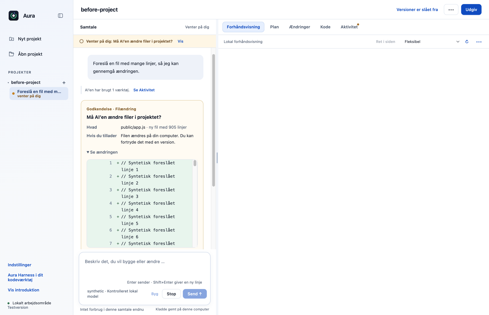
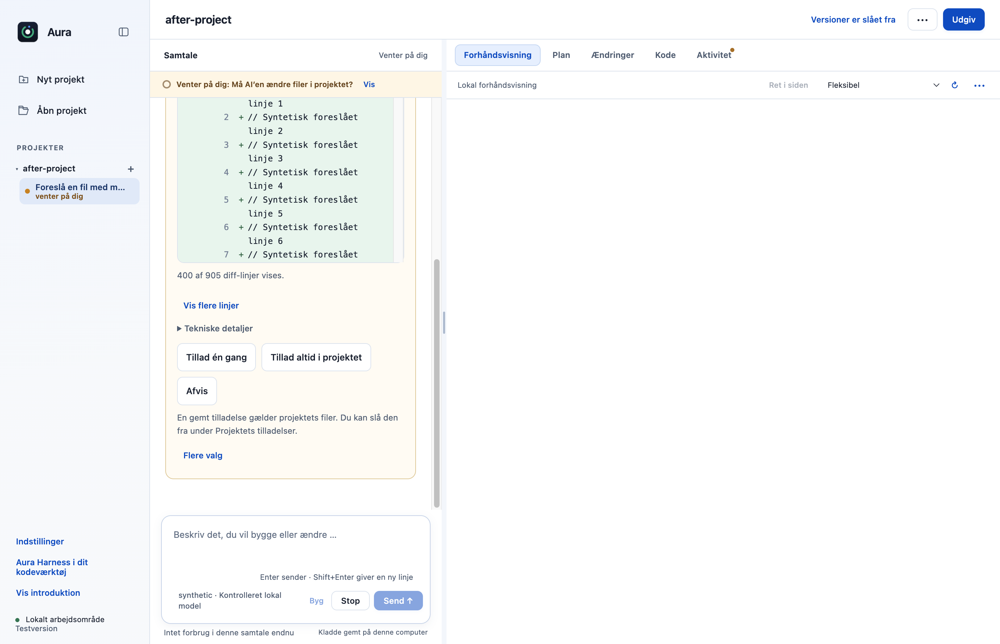
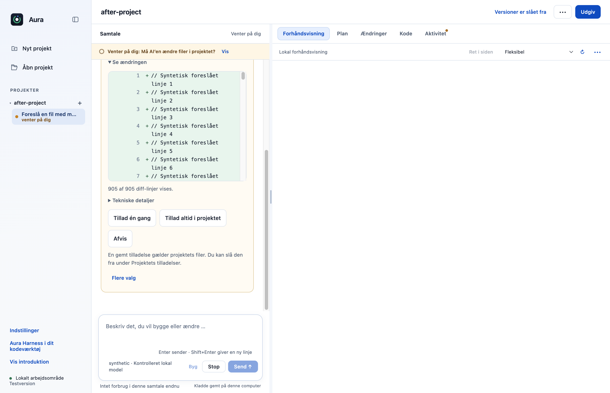

# F31: Gennemgå alle diff-linjer før en filændring godkendes

Ved større foreslåede filændringer viste godkendelsen kun de første 400 diff-linjer. Resten kunne ikke gennemgås før godkendelse. Nu kan brugeren indlæse alle linjer i portioner, se det samlede antal og fortsat bruge de samme godkendelsesvalg.

## Hvad ændres?

- Viser 400 linjer ad gangen med antal og “Vis flere linjer”, både i den første og i den foldede diff.
- Bevarer scrollposition, fokus og læsbar tekst; knappen forsvinder, når alle linjer er indlæst.
- Ændrer hverken filindhold, rettigheder eller betydningen af Tillad/Afvis.

I en lang filgodkendelse vælges **Vis flere linjer**, indtil tælleren viser alle diff-linjer. Gennemgå forslaget, og brug derefter det eksisterende valg til at tillade eller afvise ændringen.

## Før og efter

Faktiske appbilleder med syntetisk materiale: før vises kun de første 400 linjer; efter kan resten indlæses før samme eksisterende godkendelse.

| Før | Efter |
|---|---|
|  |  |

## Afprøvning

- Faktisk Electron + OpenCode 1.18.33 mod kontrolleret lokal modelserver: 905 foreslåede linjer kan læses som 400 → 800 → 905 før godkendelse.
- Ingen fil skrives før tilladelse; én konkret godkendelse skriver præcis de 905 linjer.
- Scroll bevares; ingen rendererfejl eller Git-skrivninger i nativeprøven.
- Samlet desktopgate: **514/516 består**. De to fejl i `approvals.test.cjs` ved linje 47 og 74 findes også på uændret original `dce68ea`; der er ingen nye testfejl.
- CLI: **26/26 består**.

## Bevarelse og begrænsninger

Originalens navigation, onboarding, projekter, planer og værktøjsgodkendelser bevares. De viste tillæg til de eksisterende kontroller er særskilt godkendt. Dette gør den modtagne diff fuldt læsbar. Det garanterer ikke, at en ekstern motor altid sender en komplet eller korrekt diff.

Prøvet lokalt på macOS Apple Silicon med Node 22.23.3 og Electron 44.4.4. Der er ikke brugt produktionskonti, startet GitHub Actions eller udgivet en ny DMG. T04 og F15 er derudover kontrolleret i lokale apppakker. Windows og Intel-Mac er ikke fysisk afprøvet. Originalens onboarding, planer og konkrete værktøjs-/datagodkendelser bevares.

[Måleresultat: native-report.json](f31-native-report.json).

## Genskab testene

Brug den låste Node 22.23.3-runtime. Kør `node --test --test-concurrency=1 desktop/tests/*.test.cjs` og `node --test cli/tests/*.test.cjs`. Nativebeviserne bruger Electron 44.4.4 og faktisk OpenCode 1.18.33 med syntetiske svar fra en kontrolleret lokal server.

## Review

Koden, de afgrænsede nye adfærdsveje og de faktiske appbilleder er gennemgået. Fund vedrørende kontekstbinding, pakket indlæsning, billedoverdragelse, PDF-hemmelighedskontrol og signering blev rettet og afprøvet før indsendelse. Screenshots viser syntetiske testdata.
