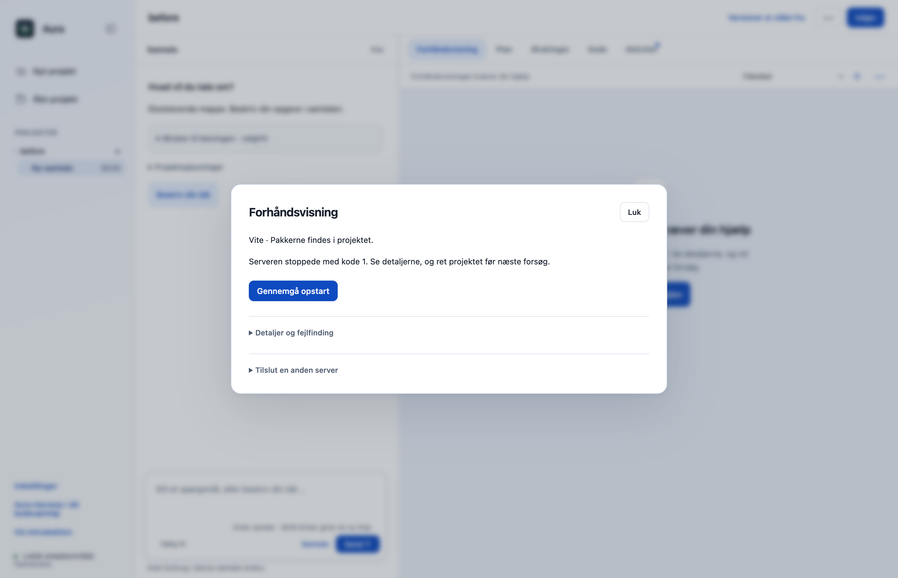
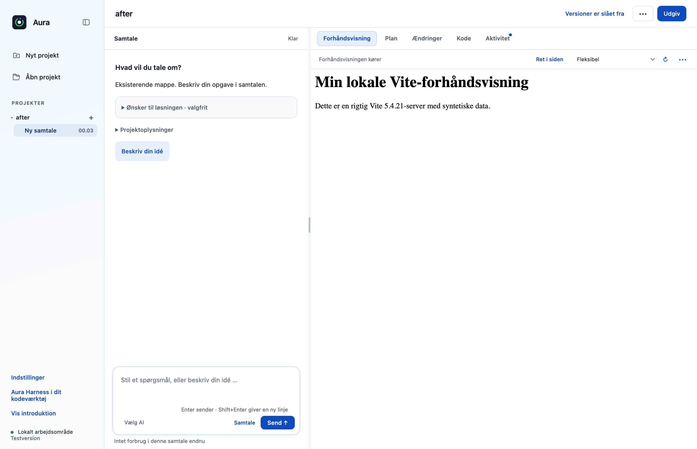
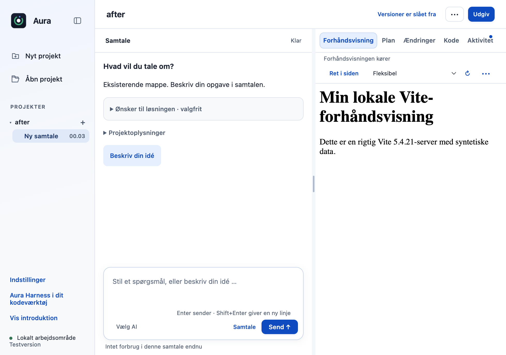

# R03: Giv lokale Vite- og Astro-forhåndsvisninger hver sin port

Når Vite 5 får port 0, kan den ende på standardport 5173. Hvis porten er optaget, starter forhåndsvisningen ikke. Aura vælger nu en konkret ledig loopback-port før opstart af Vite og Astro, så projektet får sin egen adresse.

## Hvad ændres?

- En kort lokal portprøve vælger et konkret portnummer i stedet for at sende 0 til frameworket.
- Binding til 127.0.0.1, strictPort, SDK-middleware, processtop og den eksisterende opstartsgodkendelse bevares.
- To selvstændige arbejdsmapper kan have hver sin server; stop af den ene stopper ikke den anden.

## Før og efter

Native Electron-billeder med samme syntetiske Vite 5.4.21-projekt og en bevidst optaget port 5173. Før stopper originalen med kode 1; efter kører den faktiske Vite-forhåndsvisning. Det sidste billede er et 980 × 720-vindue. Ingen ændring af appens layout eller DOM for at fremstille billederne.

| Før | Efter |
|---|---|
|  |  |

## Afprøvning

- Hele desktop- og CLI-suiten er kørt; nye fixtureprøver dækker både Vite og Astro med samtidige arbejdsmapper.
- Vite 5.4.21 installeret i separat syntetisk projekt: originalens direkte runner afviser port 5173, mens rettelsen viser siden i den rigtige app.
- To faktiske Vite 5.4.21-processer svarer på forskellige porte; den første svarer stadig, efter den anden er stoppet.
- Native prøve: nul rendererfejl, nul modelkald og nul Git-skrivninger; ingen vandret side-overflow ved 980 × 720.
- Samlet desktopgate: **516/518 består**. De to fejl i `approvals.test.cjs` ved linje47 og74 findes også på uændret original `dce68ea`; der er ingen nye testfejl.
- CLI: **26/26 består**.

## Bevarelse og begrænsninger

Portprøven er ikke en atomisk reservation frem til frameworkets binding. En efterfølgende kollision skal fortsat give en fejl. Faktisk framework- og UI-prøve er udført med Vite 5.4.21; Astro er dækket med kontrollerede API-fixtures, ikke en fysisk Astro-installation. Vite 8.3.1 kunne allerede bruge port 0 i den indledende kontrol og beskrives derfor ikke som reproduceret fejl.

Prøvet lokalt på macOS Apple Silicon med Node22.23.3 og Electron44.4.4. Der er ikke brugt produktionskonti, startet GitHub Actions eller lavet en ny installationspakke. Windows og Intel-Mac er ikke fysisk afprøvet. Originalens onboarding, planer og konkrete værktøjs-/datagodkendelser bevares.
