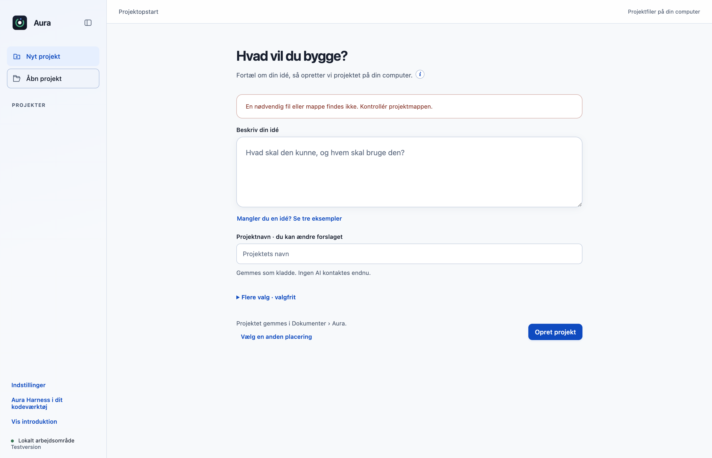
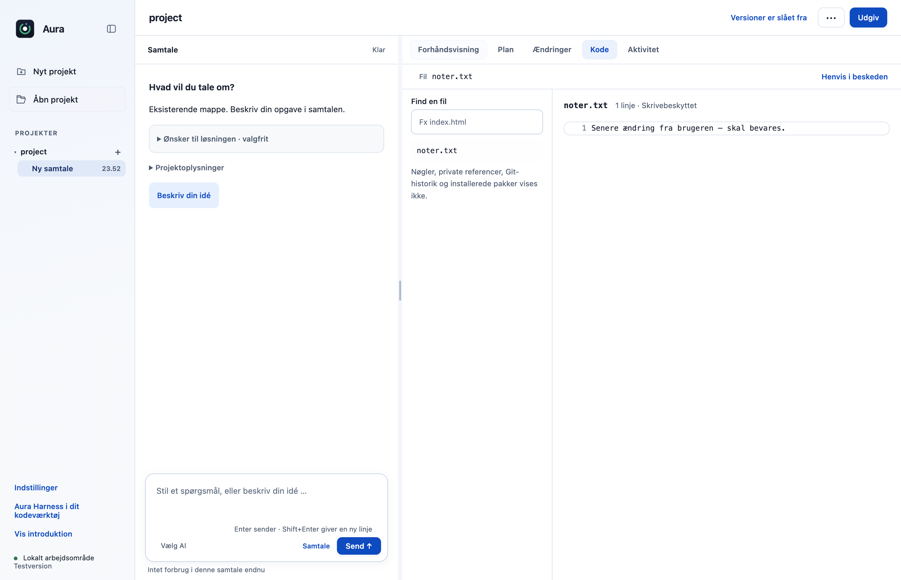

# R04: Bevar senere brugerændringer i flettede projektkopier

Efter en afsluttet indfletning kan en efterladt samtalekopi stadig indeholde nye brugerændringer. Originalens opstart slettede hele kopien alene på baggrund af merged-markøren. Bidraget kræver nu et versioneret sammenligningsgrundlag for hele det ejede træ, før en flettet kopi må ryddes op.

## Hvad ændres?

- Registrér et afgrænset metadatafingeraftryk ved markering som flettet og sammenlign på ny før opstartsoprydning.
- Medtag også nye filer, slettede/omdøbte filer, mapper, rettigheder, links, afhængigheder og filer ved siden af project-mappen.
- Bevar ældre kopier uden proof, beskadiget/ukendt grundlag og mapper der ændres eller ikke kan undersøges færdigt.
- Bevar eksisterende indfletning, fortrydelse, plan- og værktøjsgodkendelser; ingen ændring i UI-filer.

## Før og efter

Reelle Electron-optagelser med samme syntetiske scenarie: en flettet kopi får en senere brugernote, og appen genstartes. Før er kopien væk og kan ikke åbnes. Efter kan den bevarede note åbnes i den eksisterende Kode-fane. Forskellige sluttilstande er selve regressionen; ingen DOM- eller CSS-efterligning er brugt.

| Før | Efter |
|---|---|
|  |  |

## Afprøvning

- Fejlen reproduceret på uændret original: laterChangesPreserved=false; porteringen giver true. Hovedprojektet er uændret i begge tilfælde.
- Tre nye regressionstests dækker bl.a. samme filstørrelse og gendannet mtime, nye/slettede filer, node_modules, filer ved siden af project, legacy-proof, erstattet kopirod, omdøbning, tom mappe, rettigheder og ødelagt proof.
- Faktisk native opstart og mappeåbning består før/efter med 0 rendererfejl, 0 Git-skrivninger og ingen modelkonto.
- Eksisterende kopiering, konfliktgennemgang, indfletning og fortrydelse er med i kildegaten.
- Samlet desktopgate: **517/519 består**. De to fejl i `approvals.test.cjs` ved linje47 og74 findes også på uændret original `dce68ea`; der er ingen nye testfejl.
- CLI: **26/26 består**.

## Bevarelse og begrænsninger

Sammenligningen er konservativ og tids-/antalsafgrænset. Den er ikke en atomisk OS-fillås og kan ikke love beskyttelse mod en samtidig ekstern skrivning mellem sidste kontrol og sletning. Ukendt eller ændret grundlag bevares; ældre efterladte kopier kræver manuel gennemgang. Ingen nye afhængigheder eller rettigheder.

Prøvet lokalt på macOS Apple Silicon med Node22.23.3 og Electron44.4.4. Der er ikke brugt produktionskonti, startet GitHub Actions eller lavet en ny installationspakke. Windows og Intel-Mac er ikke fysisk afprøvet. Originalens onboarding, planer og konkrete værktøjs-/datagodkendelser bevares.
