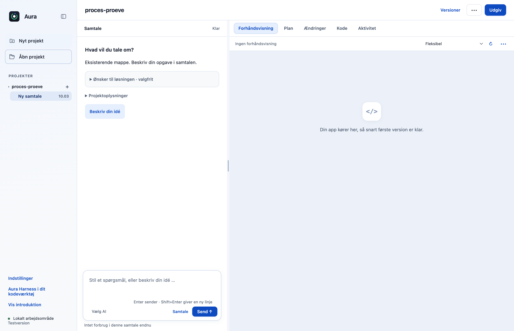

# Stop ejede OpenCode-processer efter brat app-lukning (R05)

Hvis Aura eller terminalklienten tvangslukkes, får den eksisterende nedlukningskode aldrig mulighed for at stoppe OpenCode. En lille lokal guardian knytter motorens procesgruppe til ejerens private IPC-forbindelse og rydder gruppen op, når forbindelsen lukkes. Almindeligt Stop, sessionshistorik, planer og godkendelser bevarer deres adfærd.

## Hvad ændres?

- På macOS/Linux startes OpenCode under en lokal guardian med en privat IPC-forbindelse til ejeren. Ingen PID kommer fra brugerfladen eller modellen.
- Ved ejerens exit eller tab af IPC sendes TERM til den ejede procesgruppe og derefter KILL efter to sekunder ved behov. Et uventet motorstop afslutter også gruppens resterende processer.
- Electron-flaget `ELECTRON_RUN_AS_NODE` sættes på guardian-processen, så udviklingsudgavens Electron kan køre den som Node, og fjernes før den faktiske motor startes. Flaget føres derfor ikke videre til brugerens Electron-projekter.
- Guardian-filen pakkes uden for app.asar, hvor den bundtede Node kan starte den. Windows beholder den tidligere direkte spawn/close; der tilføjes ingen uprøvet Job Object-løsning.

## Før og efter

Appens UI er uændret. De faktiske Electron-billeder nedenfor viser samme projekt og kontroller før/efter. Procesforbedringen er verificeret separat med en rigtig OpenCode 1.18.33-session: efter ejerens SIGKILL overlevede 1/1 motorproces i originalen; med ændringen overlevede 0/2 ejede processer (guardian + motor). Den oprindelige prøvemotor blev derefter afsluttet eksplicit af prøven.

| Før | Efter |
|---|---|
|  |  |

## Afprøvning

- Tre faktiske procesprøver: SIGKILL af ejer, uventet motorstop med TERM-ignorerende efterkommer, og normal guardian-lukning. En separat prøveproces overlever; Electron-flaget arves ikke.
- Før/efterprøve med den låste, rigtige OpenCode-motor: opretter session, validerer effektiv konfiguration og måler overlevende ejede processer efter faktisk SIGKILL af ejer. Ingen modelkald eller konti bruges.
- Native Electron-prøve af original og ændret app: projektåbning, skrivefelt og modelvalg synlige; ingen rendererfejl og ingen Git-skrivninger.
- Efter `npm run runtime:prepare` i `desktop/` gentages motorprøven fra repositoryets rod med `node desktop/scripts/verify-engine-guardian.cjs`. Den starter ingen AI-opgave og læser ingen gemt nøgle. Prøven fjerner sine egne midlertidige filer og eventuelt overlevende prøveprocesser.
- Samlet desktopgate: **517/519 består**. De to fejl i `approvals.test.cjs` ved linje47 og74 findes også på uændret original `dce68ea`; der er ingen nye testfejl.
- CLI: **26/26 består**.

## Bevarelse og begrænsninger

Beskyttelsen omfatter motorens egen POSIX-procesgruppe. Det er procesoprydning, ikke en sikkerhedssandbox eller en garanti for processer, som bevidst løsriver sig med en ny session/procesgruppe. macOS Apple Silicon er faktisk afprøvet; Linux er ikke fysisk afprøvet, og Windows beholder sin tidligere adfærd. De to kendte baselinefejl i godkendelsestestene er ikke ændret af denne PR.

Prøvet lokalt på macOS Apple Silicon med Node22.23.3 og Electron44.4.4. Der er ikke brugt produktionskonti, startet GitHub Actions eller lavet en ny installationspakke. Windows og Intel-Mac er ikke fysisk afprøvet. Originalens onboarding, planer og konkrete værktøjs-/datagodkendelser bevares.

[Måleresultat: real-engine.json](r05-real-engine.json).

[Måleresultat: portable-proof.json](r05-portable-proof.json).

[Måleresultat: native-report.json](r05-native-report.json).
