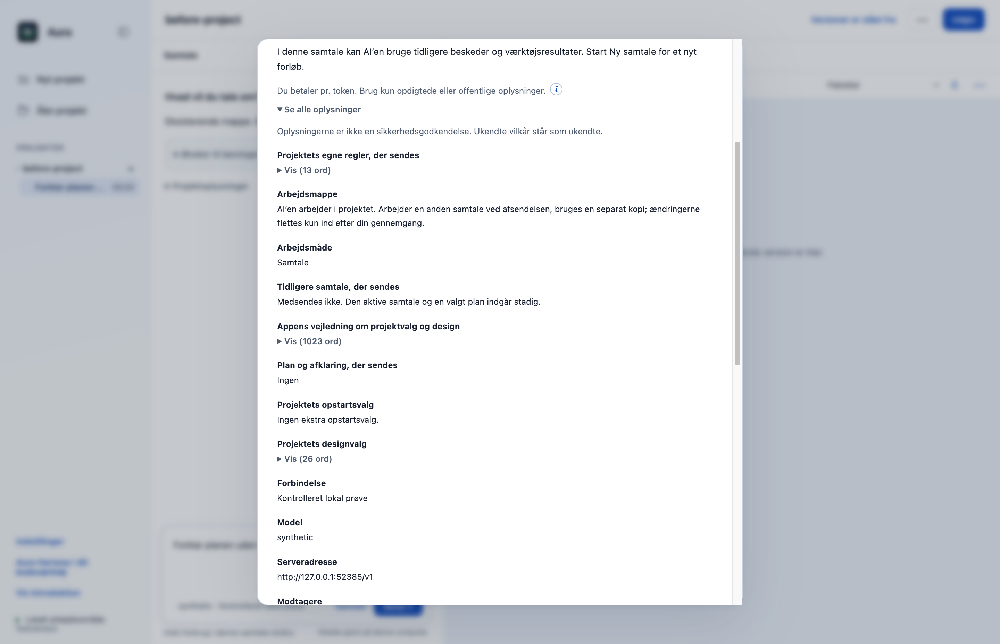
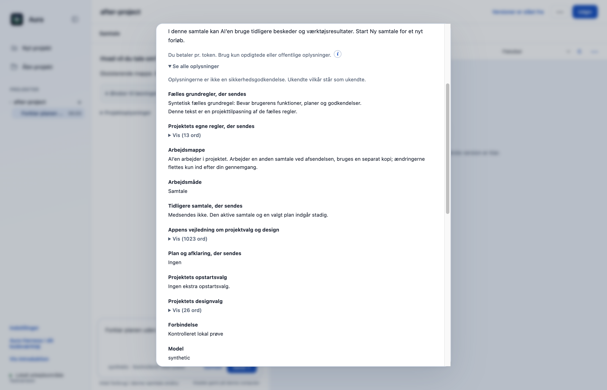

# R06: Vis de faktiske fælles grundregler før afsendelse

De fælles Harness-grundregler sendes til modellen, men mangler i originalens eksisterende datagennemgang. Nu viser Se alle oplysninger den præcise effektive regeltekst, inklusive projektets egne tilpasninger.

## Hvad ændres?

- Den forberedte datagennemgang indeholder samme context.rules-tekst som modellens systeminstruktioner.
- En ny række i den eksisterende oplysningsliste viser Fælles grundregler, der sendes; lange tekster bruger den eksisterende fold.
- Reglerne indgår fortsat i fingerprint og sessionsidentitet. Projektets AGENTS.md, øvrige oplysninger, planvalg og værktøjsgodkendelser bevares.

## Før og efter

Native før/efterbilleder fra den eksisterende Før du sender-dialog, med en kort syntetisk projekttilpasning af grundreglerne. Før mangler rækken; efter vises den præcise tilpassede tekst. Billederne er taget før godkendelse og uden modelkald.

| Før | Efter |
|---|---|
|  |  |

## Afprøvning

- Ny regressionstest kontrollerer standardregler, projekttilpasning og ændret fingerprint.
- Faktisk Workbench → OpenCode → kontrolleret lokal OpenAI-kompatibel server: den viste regeltekst genfindes præcist i systembeskeden. Prøvet i desktop Samtale, desktop Planlæg og CLI Byg.
- Indlæsningsprøven kontrollerer stadig projektregler med kilde, afvist afsendelse ved ændret AGENTS.md, ny modelsession og kun de valgte skills.
- Native før/efter: ingen model-POST før godkendelse, nul rendererfejl og nul Git-skrivninger.
- Samlet desktopgate: **515/517 består**. De to fejl i `approvals.test.cjs` ved linje47 og74 findes også på uændret original `dce68ea`; der er ingen nye testfejl.
- CLI: **26/26 består**.

## Bevarelse og begrænsninger

Dette er synliggørelse af eksisterende modelinstruktioner, ikke en ny dataisolations- eller sikkerhedsgaranti. Modelserveren var en kontrolleret lokal testserver, ikke en betalt eller ekstern AI. Den eksisterende lange dialog kræver stadig rulning for at se alle oplysninger.

Prøvet lokalt på macOS Apple Silicon med Node22.23.3 og Electron44.4.4. Der er ikke brugt produktionskonti, startet GitHub Actions eller lavet en ny installationspakke. Windows og Intel-Mac er ikke fysisk afprøvet. Originalens onboarding, planer og konkrete værktøjs-/datagodkendelser bevares.
