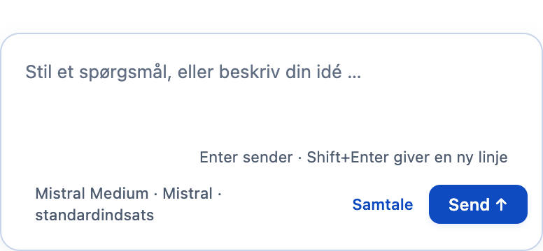
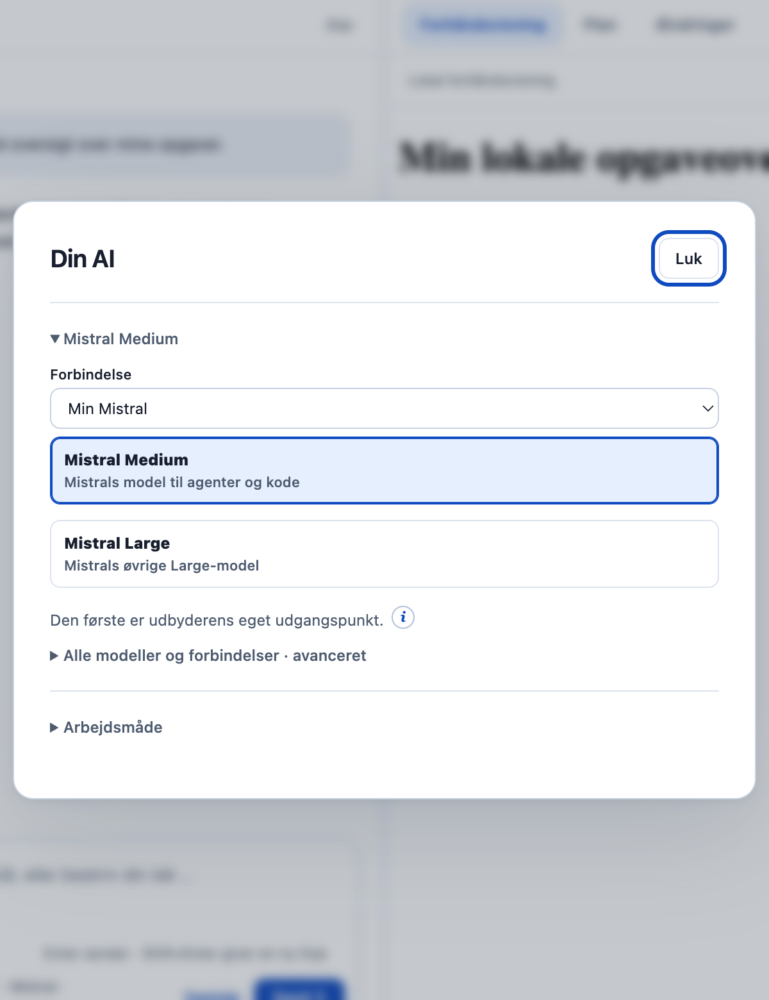
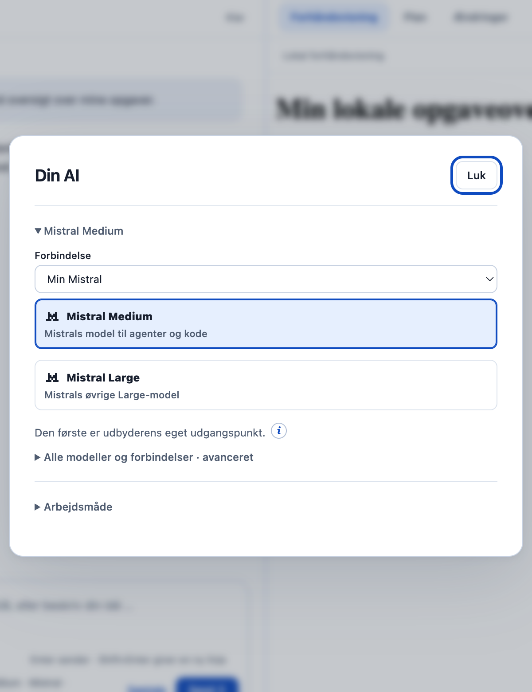
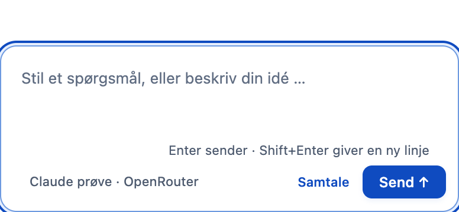
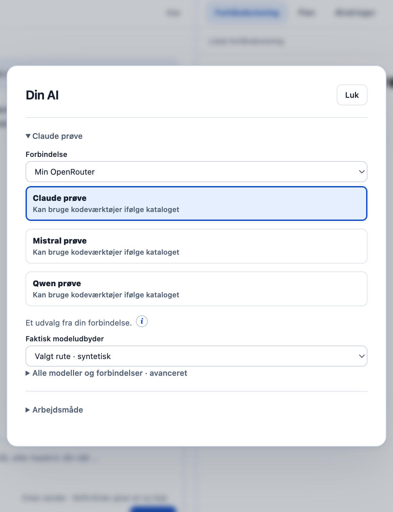
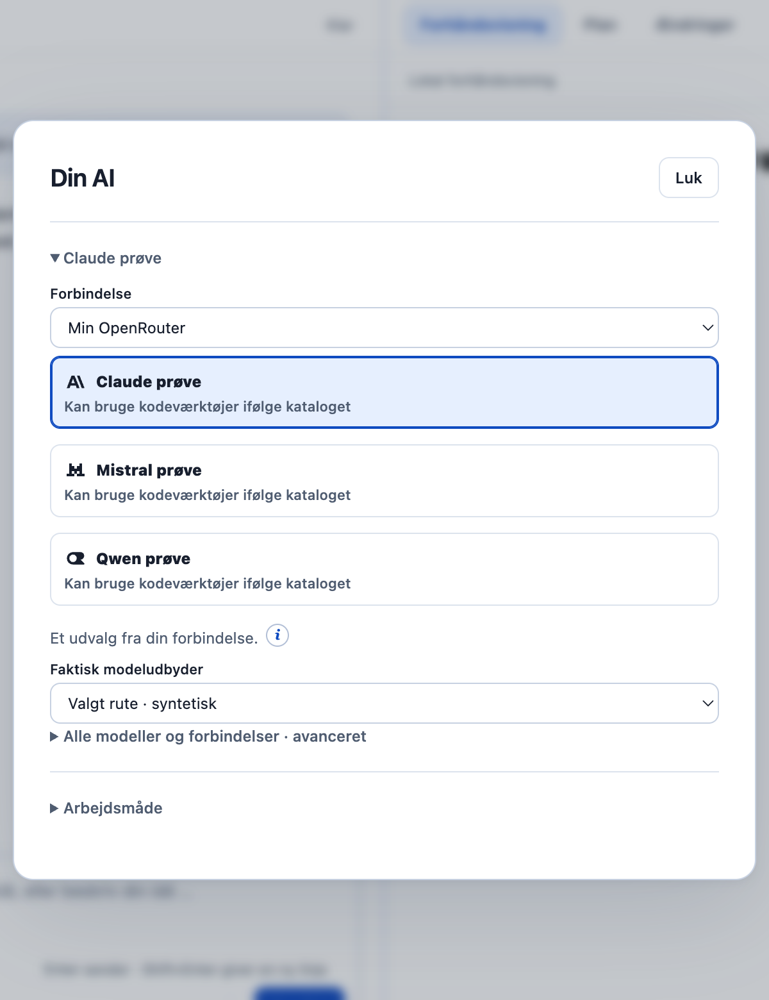
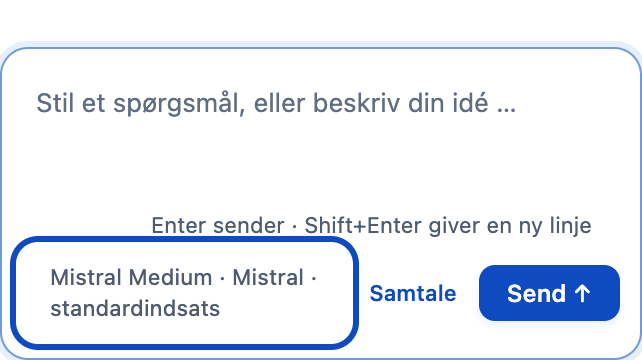
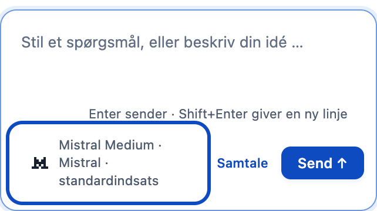

# F03 · genkend modellen med et lokalt logo

Aura viser allerede modelnavn, AI-forbindelse og eventuel indsats under chatfeltet. F03 føjer et lille logo til det valgte modelnavn og de eksisterende modelvalg i dialogen **Din AI**, så brugeren hurtigere kan genkende sin AI. Den nuværende modeldialog, valgene og den læsbare tekst bevares.

Et eksempel er **Claude prøve · OpenRouter**: Anthropic-mærket identificerer modellen, mens teksten fortsat siger OpenRouter. Den valgte forbindelse, det præcise model-id og feltet **Faktisk modeludbyder** bevares. Mærket dokumenterer hverken, hvem der behandler data, hvor data behandles, eller om en forbindelse virker. De oplysninger skal fortsat vurderes i Auras eksisterende gennemgang.

## Hvad der ændres

- Chatfeltets modelknap får et lokalt logo foran det eksisterende navn. Et klik åbner stadig samme dialog; knappen skifter ikke selv model.
- Modellisten får de samme små mærker ved navnene. Rækkefølge, beskrivelser, forvalg og den faktiske modelhandling bevares.
- Ved OpenRouter vises Anthropic-, OpenAI- eller Mistral-mærket, når modellens kendte id-præfiks angiver den pågældende modeludgiver. Andre modeludgivere får OpenRouter-mærket. Mærket ændrer ingen rute.
- En ukendt forbindelse vises som tekst uden et gættet logo. Intet modelvalg giver stadig **Vælg AI** uden logo.
- En igangværende opgave beholder sit afsendte modelnavn og mærke, når brugeren vælger en anden model til næste opgave. Ældre visninger uden disse ekstra visningsoplysninger beholder teksten uden et gættet mærke.

Logoerne er dekorative, har tom alternativ tekst og er skjult for skærmlæserens navngivning. Model- og forbindelsesnavne forbliver tekst. Kun en fast liste af eksisterende lokale SVG-filer kan bruges; værdier fra modelkataloget bliver aldrig billedadresser eller HTML.

## Før og efter

Billederne kommer fra den rigtige Electron-renderer med samme syntetiske projekt og modelkatalog. **Før** er taget fra den urørte original `dce68ea74a199ca214ab535a16ff22765d8ee8de`; **efter** er denne branches kode. Hvert par bruger identisk viewport og fast beskæring. Der er ingen rigtig AI-kørsel eller kontoadgang i billederne.

| Visning | Før | Efter |
|---|---|---|
| Valgt Mistral-model under chatfeltet |  |  |
| De eksisterende modelvalg |  |  |
| Claude via OpenRouter |  |  |
| OpenRouter og konkret rute |  |  |
| Smalt vindue på 720 px |  |  |

Kontrollernes øvrige udseende kommer fra originalen. F03 kopierer ingen Aura 1-temaer, onboarding, popover-menu eller ny typografi. Mærkerne genbruger originalens allerede medleverede, primært ensfarvede logoer; der tilføjes ingen nye brandfiler.

## Afprøvning

| Prøve | Resultat | Hvad det viser |
|---|---|---|
| Nye adfærdstests | 9/9 består | Lokale assets, OpenRouter-præfiks, ukendt udbyder, tekstbehandling, genoptegning, afsendelsens visningsmetadata og bevaring af model-id/rute/fingeraftryk/plan. |
| Hele desktop-testpakken | 523/525 består | To eksisterende fejl i originalens `approvals.test.cjs:47` og `:74` er stadig til stede. Hele pakken er derfor ikke grøn. |
| CLI-testpakken | 26/26 består | Den eksisterende CLI er fortsat afprøvet separat. |
| Rigtig Electron på macOS med kontrolleret modelkatalog | 13/13 består | Før/efter, almindeligt modelklik, tastatur, Escape, OpenRouter-rute, næste model under igangværende opgave, ukendt udbyder, HTML-lignende modelnavn, 720 px, reduceret bevægelse og systemets kontrastfarver. Ingen rendererfejl, eksterne HTTP/S-forsøg eller Git-skrivninger i prøven. |

De to eksisterende fejl er **Godkendelsen findes ikke længere.** og **Cannot read properties of undefined (reading 'properties')**. F03 ændrer ikke godkendelseslogik for at skjule dem.

Prøven bruger Electron 44.4.4 og Playwright 1.63.0 med Node 22.23.3. Alle billede- og kildehashes, viewportmål, beskæringer og kontrolpunkter står i [valideringsrapporten](f03-provider-branding-validation.json). De to syntetiske testprofiler blev først fjernet, efter appforløbene var lukket; billeder og rapport er bevaret.

### Sådan gentages prøven

Kør fra repository-roden med projektets låste Node-runtime og installerede desktop-afhængigheder:

```sh
node --test desktop/tests/provider-brand.test.cjs
node --test desktop/tests/*.test.cjs
node --test --test-concurrency=1 cli/tests/*.test.cjs
AURA_BRAND_BASELINE=/sti/til/uroert-original-checkout \
AURA_BRAND_OUTPUT=/sti/til/nyt-output \
node desktop/scripts/verify-provider-branding.cjs
```

Baseline-mappen skal være en separat original-checkout uden F03, på den dokumenterede commit, med desktop-runtime klargjort. Appprøven opretter sine egne syntetiske profiler og blokerer Git-skrivninger og HTTP/S-forsøg. Den gemmer ingen forbindelse eller nøgle.

## Afgrænsning og rettigheder

F03 tilføjer ingen afhængigheder, login, modelkald, ny netværksadgang, IPC-handler eller værktøjsrettighed. `main.cjs` tillader kun, at appens eksisterende lokale protokol indlæser det nye visningsmodul. Planer, datagennemgang, samtykke, godkendelser, genveje og afsendelsesparametre bevares.

De eksisterende aktiver og [deres licensoplysninger](../desktop/ui/provider-icons-LICENSE.txt) er uændrede. Der er ingen ny download eller ny tredjepartspakke.

Windows, skærmlæserbetjening, rigtig modelkørsel, datamodtagelse hos en udbyder, pakkebygning, DMG, signing og GitHub CI er ikke afprøvet i dette bidrag. Native-prøven beviser brugerfladens adfærd med kontrollerede data; den er ikke en live AI- eller releaseprøve. Ingen workflow er startet.
