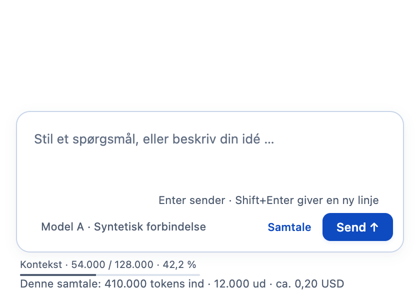
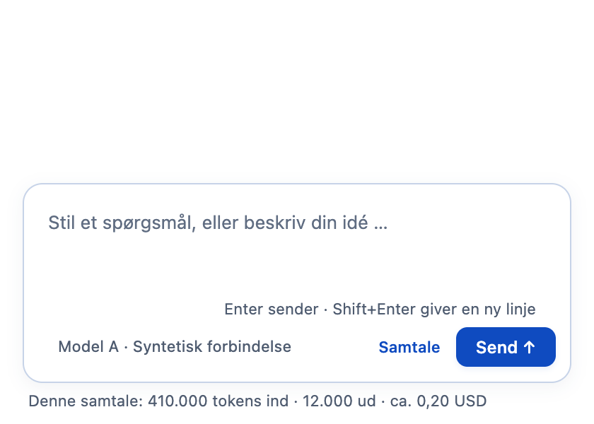
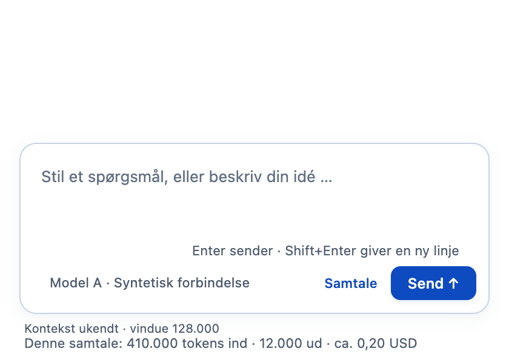
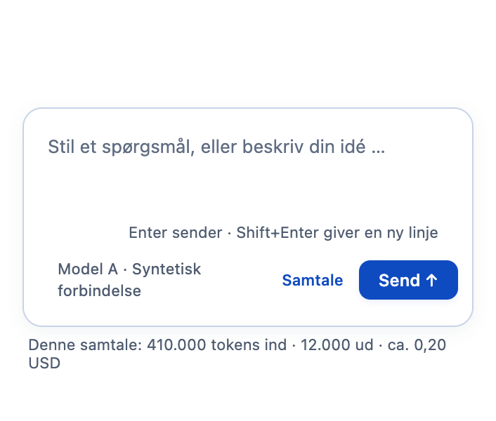
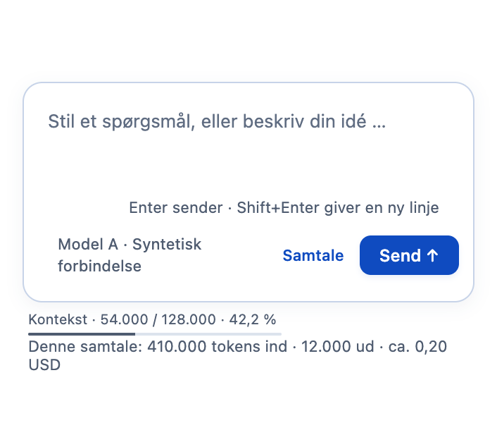

# F07: Kontekst og samlet forbrug er to forskellige oplysninger

Aura viser allerede samtalens samlede tokens og anslåede pris under skrivefeltet. Summen kan være større end modellens kontekstvindue, fordi de samme oplysninger kan være sendt flere gange. Den fortæller derfor ikke, hvor meget kontekst et enkelt modelkald brugte.

F07 tilføjer en særskilt linje og en lille måler med **det senest afsluttede modelkalds input i forhold til modellens oplyste kontekstvindue**. Den eksisterende forbrugslinje bevares.

Eksempel: Samtalen har samlet brugt 410.000 inputtokens. Det senest afsluttede kald havde 44.000 nye inputtokens og 10.000 cachetokens. Med et oplyst vindue på 128.000 viser den nye linje **Kontekst · 54.000 / 128.000 · 42,2 %**. Det er ingen garanti for størrelsen på næste forespørgsel eller en komplet optælling af al aktuel hukommelse. Værktøjer, sammenfatning og senere beskeder kan ændre konteksten.

## Før og efter i den rigtige app

Hvert par viser samme syntetiske projekt, modelvalg, tal, vinduesstørrelse og beskæring. Før-billedet kommer fra den uændrede original på `dce68ea74a199ca214ab535a16ff22765d8ee8de`; efter-billedet kommer fra denne branches Electron-renderer. Billederne bruger kontrollerede IPC-hændelser og er ikke bevis på en rigtig AI-kørsel. Ingen konto eller adgangsnøgle bruges.

| Visning | Før | Efter |
| --- | --- | --- |
| Sidste målte kald og samlet forbrug |  |  |
| Ufuldstændige inputtal |  |  |
| Smalt vindue på 720 pixels |  |  |

## Hvad måles?

- Kun et afsluttet, unikt `step-finish` fra den eksisterende motor bruges. Samtalens akkumulerede totaler, svartekst og outputtokens bruges aldrig til at gætte kontekst.
- Input, læst cache og skrevet cache skal alle være kendte, ikke-negative heltal. Manglende eller ugyldige felter giver **Kontekst ukendt**. Nul er derimod en gyldig måling.
- En procent kræver et kendt, positivt kontekstvindue. Et oplyst katalogvindue kan vises, selv om inputmålingen er ukendt, men det bliver ikke til en måling.
- Målingen tilhører forbindelse, model, præcis rute, motorversion og modelsession i netop den samtale. Et andet katalog med samme model-id kan ikke levere et vindue til en kørende opgave på en anden forbindelse.
- En igangværende opgave beholder sit afsendte modelvalg, selv om brugeren vælger en anden model til næste opgave. Hændelser fra en baggrundssamtale ændrer ikke den åbne samtales visning.
- En ny session eller genstart har ingen genskabt måling. Funktionen gemmer ikke rå prompts eller en ny historik. Den eksisterende samtales totalforbrug gemmes fortsat som før.
- Teksten viser også værdier over 100 %, hvis de rapporteres. Selve måleren begrænses visuelt til sit maksimum; overskridelsen skjules ikke i teksten.

## Bevarede funktioner

Der ændres ingen modelrouting, afsendelsesparametre, planer, godkendelser, tilladelser, onboarding eller øvrige brugerforløb. Målingen føjes til den eksisterende samtalevisning og den eksisterende forbrugshændelse. Den giver ingen adgang til filer eller netværk og påvirker ikke token- eller prisberegningen.

Den nye visningsfil indlæses gennem appens eksisterende lokale protokol. Der tilføjes ingen pakker, eksterne assets, nye IPC-handlinger eller nye netværksmodtagere. Den lille måler har en læsbar tekst og en tilgængelig beskrivelse; betydningen forklares også i linjens hjælpetekst.

## Afprøvning

De nye tests undersøger den faktiske `ChatSession` og dens eksisterende hændelser samt de rene måle- og visningsfunktioner. De dækker cache, dublerede trin, ukendte og ugyldige tal, nul, overskridelse, model/rute/session/motorskift, en anden forbindelse med samme model-id, flere samtaler og lukning. Planer og godkendelser afprøves fortsat af den eksisterende samlede pakke.

Den separate appprøve består **14/14 kontrolgrupper** med faktiske før-/efteroptagelser, kontrolleret modelkatalog og IPC-hændelser. Den kontrollerer uændrede forbrugstotaler, ukendt input, model- og ruteskift, næste model under en kørende opgave, baggrundssamtaler og 720 pixels. Der var ingen rendererfejl, eksterne HTTP/S-forsøg eller Git-skrivninger.

**9/9 nye tests, 523/525 desktoptests og 26/26 CLI-tests består.** Der er ingen nye fejl i forhold til originalens 514/516 desktoptests. Se slutresultater, kildehashes og billedproveniens i [valideringsrapporten](f07-context-usage-validation.json). Den samlede desktoptest har de samme to kendte fejl som den uændrede original i `approvals.test.cjs:47` og `:74`; hele pakken kaldes derfor ikke grøn.

Kørt på macOS Apple Silicon med Node 22.23.3 og Electron 44.4.4. Der påstås ingen rigtig AI-/kontoprøve, Windows-, Linux- eller skærmlæserafprøvning, pakkebygning, DMG eller release. GitHub Actions er ikke startet.

## Gentag prøverne

Fra projektroden med desktopafhængigheder og runtime klargjort:

```sh
node --test desktop/tests/context-usage.test.cjs desktop/tests/context-display.test.cjs
node --test --test-concurrency=1 desktop/tests/*.test.cjs
node --test --test-concurrency=1 cli/tests/*.test.cjs
AURA_CONTEXT_BASELINE=/sti/til/uroert-original-checkout \
AURA_CONTEXT_OUTPUT=/sti/til/nyt-output \
node desktop/scripts/verify-context-usage.cjs
```

Appprøven opretter egne syntetiske profiler, lukker appen efter hvert forløb og gemmer billeder samt en lokal detaljerapport. Rapporten kan indeholde prøveprofilens filsti og skal gennemgås før deling. Den versionsstyrede rapport er særskilt renset for lokale profiler og filstier.
