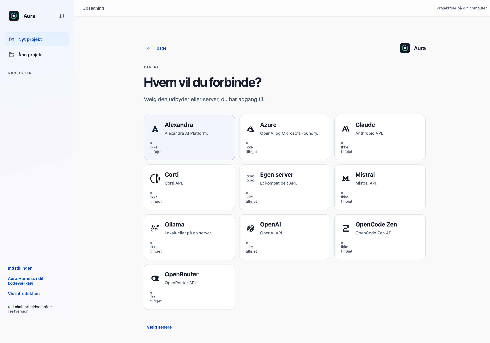
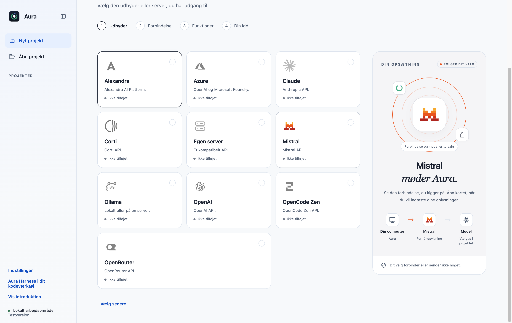
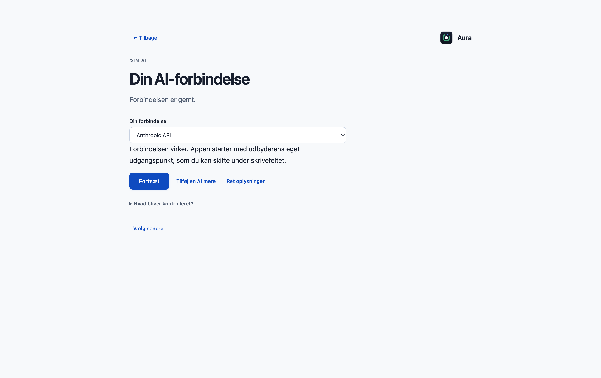
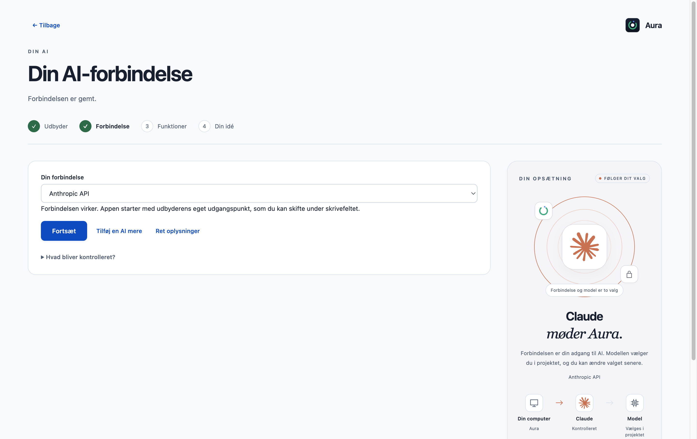
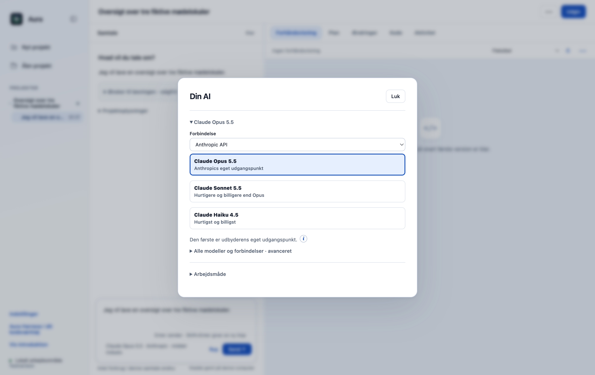
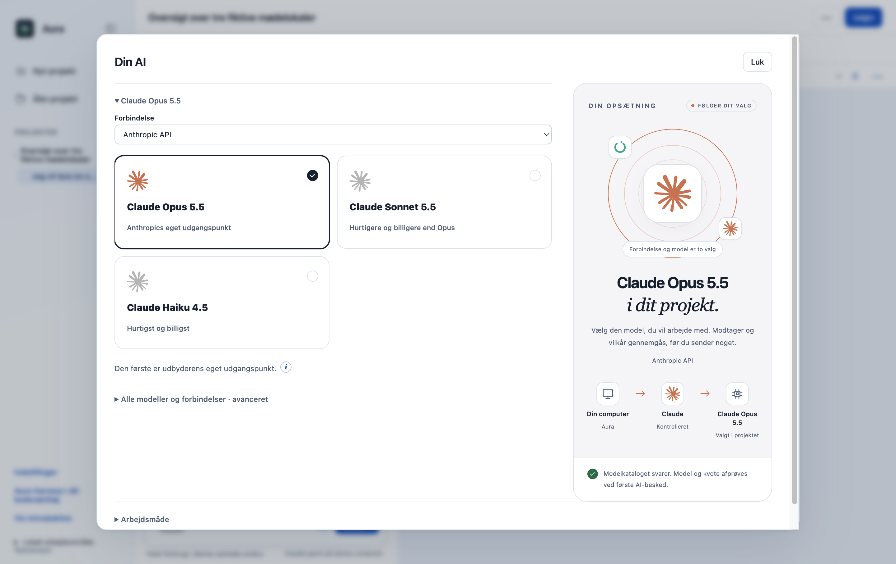
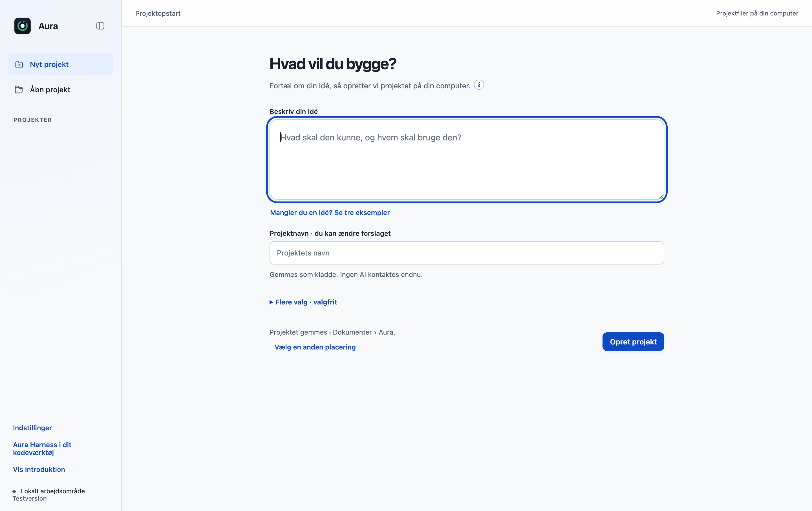
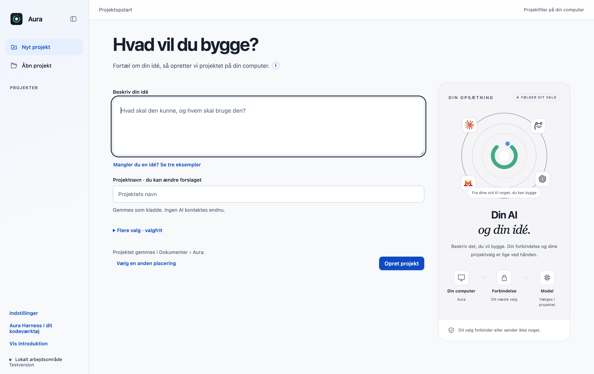

# F20 · visuel AI-opsætning og modelvalg

Dette bidrag samler onboarding B’s præsentation i original Aura: store neutrale kort, lokale udbyderlogoer, brandfarver og en visualisering til højre. AI-opsætning, projektopstart og den eksisterende **Din AI**-dialog bruger samme præsentationsmodul.

## Det ændrer sig

- Udbyderkortene får mere plads, tydelige statusser og lokale brandmærker. Hover og tastaturfokus opdaterer visualiseringen uden modelkald eller formularåbning.
- Højrevisualiseringen forklarer computer → forbindelse → model og viser eksisterende kontrollers faktiske tilstand. Forhåndsvisning, gemt forbindelse og bestået katalogkontrol er forskellige tilstande.
- Modelkortene i **Din AI** får samme visuelle form og et udbydermærke. Modellen vælges fortsat i projektet gennem den eksisterende modelcontroller.
- Den samme opstilling bruges ved projektidéen. Smalle vinduer, synligt fokus og reduceret bevægelse understøttes.

Originalen har allerede de ti udbydere, udbyder- og modelkort, søgning, forbindelseskontrol og responsivt layout. Bidraget forbedrer deres præsentation; det introducerer ikke funktionerne fra bunden. Originalens rækkefølge bevares: **forbindelse → funktioner → idé → projekt**. Der tilføjes intet nyt obligatorisk modeltrin før projektoprettelse.

## Bevarede funktioner og grænser

Originalens ti udbydere, gemte forbindelser, credentialfelter, modelkatalog, OpenRouter-ruter, funktionsvalg og projektfiler bevares. De eksisterende controllere ejer fortsat projektskabelse, modelsamtykke, planer og værktøjsgodkendelser. Produktnavnet er fortsat **Aura**.

Der tilføjes ingen afhængigheder, IPC-metoder, modelkald, persistensformater eller datarettigheder. `main.cjs` tillader kun fem konkrete nye lokale UI-ressourcer med de tilsvarende MIME-typer. Arbejdsområdet og de øvrige funktionsskærme redesignes ikke. Funktionel AI-idéhjælp, screenshot-upload, chatfeltets glow, Privacy Gate, den nye designskill og Code-OSS følger ikke med F20.

## Før og efter

Billederne er faktiske Electron-skærmbilleder med syntetiske projekter fra den urørte original og F20-grenen. Originalens basecommit er `dce68ea74a199ca214ab535a16ff22765d8ee8de`; den visuelle feature er `6fbead9558e099a24c88ed0bc78d8c75721b9c78`. PNG-filerne er kopieret uden billedredigering. [Proveniens og hashes](images/onboarding-b/provenance.json) angiver dimensioner og begrænsninger. Udbyderoversigtens billeder har forskellig vindueshøjde/rulleposition; de øvrige par har samme dimensioner.

| Flade | Før | Efter |
| --- | --- | --- |
| Udbydere |  |  |
| Forbindelse |  |  |
| Modelvalg |  |  |
| Projektidé |  |  |

## Afprøvning

Se [den afgrænsede teststatus](onboarding-b-validation.json). Kildeprøver, native UI-prøver, kontrolleret modelserver og eksterne kontoprøver er separate. De to kendte fejl i originalens fulde enhedssamling er ikke skjult eller rettet som del af denne visuelle PR. Windows, rigtige AI-konti og en installationspakke er ikke kvalificeret her.

Reproduktion fra `desktop/` efter installation af de låste afhængigheder og runtime:

```sh
node --test --test-concurrency=1 tests/*.test.cjs
node scripts/verify-onboarding-b.cjs
node scripts/verify-introduction.cjs
node scripts/verify-setup.cjs
node scripts/verify-connections.cjs
node scripts/verify-preferences.cjs
node scripts/verify-layout.cjs
AURA_MEASURE_NO_GIT=1 node scripts/measure-screens.cjs /sti/til/resultater
```

GitHub Actions startes kun efter en konkret aftale med vedligeholderen. Denne PR ændrer ingen workflows og udgiver ingen app eller pakke. Logoernes kilder og attribution står i [provider-icons-LICENSE.txt](../desktop/ui/provider-icons-LICENSE.txt).
